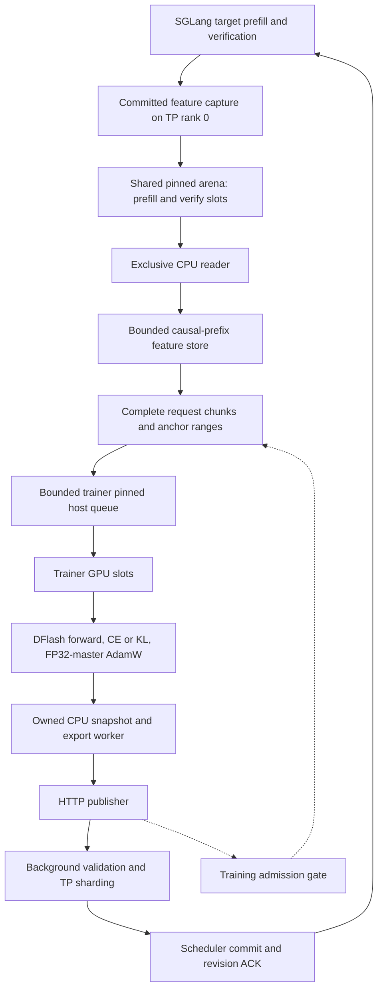

# Adaptive spec v0 review and v1 design questions

`adaptive-spec-v0` implements a complete online draft adaptation loop: observe
real SGLang traffic, capture target features, reconstruct training context,
update a DFlash draft, export it, and publish new weights to the serving engine.
Its strongest contributions are the explicit token-alignment contract, bounded
memory ownership, and separation of weight preparation from the serving commit.

V1 will be implemented from scratch, using v0's experiments to inform correct
foundations and design. Its contracts need to identify the exact teacher,
account for missing context, and define the lifecycle of draft KV across updates.
Evaluation must establish a net serving benefit against a strong fixed draft.
`dtrain` provides useful model, loss, checkpoint, and distributed
runtime machinery. Its controlled prefill pipeline has different ownership and
backpressure requirements from passive capture of live requests.

This is a local engineering review for planning v1. Sections describing v0
refer to the inspected implementation; the proposed v1 sections are design
choices to review. Performance figures are archived experiment results, with
their measurement boundaries preserved.

## Agreed v1 working rules

Correctness and design come first. V0 supplies experimental evidence and useful
failure cases; its APIs, wire formats, checkpoint formats, flags, layout, and
abstractions impose no backward-compatibility requirement on v1. Choose the
contracts that serve the supported v1 behavior, without speculative migration
paths or compatibility shims.

Keep SGLang changes as small and focused as the feature allows. Reuse existing
logic and integration points, and keep adaptation-specific policy outside the
serving engine where practical. Existing SGLang behavior and supported callers
remain part of the correctness review. Avoid unrelated cleanup, renames,
formatting churn, and fixture changes. A smaller diff must still make ownership,
failure handling, and useful validation clear.

Design and refine features with the user throughout implementation. Surface
consequential choices and tradeoffs while they are still easy to change. The
proposals later in this document are discussion inputs; each feature's agreed
scope determines its implementation.

The agreed draft-cache direction is now raw target-feature tails owned with
recurrent checkpoints and active requests, plus bounded materialized draft KV
in unified SWA storage. Keep active requests' latest raw tails on GPU and
offload cached checkpoint tails to the HiCache host tier. Draft updates or KV
eviction must not require replay of cached target history. See the
[checkpoint design and memory estimate](draft-kv-checkpoint-design.md).

### Feature completion includes a minimization pass

For every feature:

1. Establish the intended behavior, supported scope, invariants, ownership,
   lifecycle, and failure outcomes through design discussion.
2. Implement the smallest clear change that satisfies that contract, and verify
   correctness with appropriate checks.
3. Run a focused minimization pass over the feature's changed code before
   treating it as complete. Reduce complexity, diff size, and regression risk
   while preserving readability and correctness.
4. Recheck behavior affected by the simplification. Report the correctness
   evidence, meaningful simplifications, and any complexity that remains
   necessary so the user can review and refine the feature.

The minimization pass follows these criteria:

| Review area | What to check |
| --- | --- |
| Focused diff | Remove incidental rewrites and churn; preserve useful checks and context. Fewer lines alone do not establish an improvement. |
| Proven invariants | Remove a branch, check, or fallback only after establishing the invariant across supported callers. Comments and a single successful run are insufficient evidence. |
| Control flow | Use guard clauses, early returns, or a cohesive helper when they clarify nesting. Preserve cleanup, bookkeeping, side effects, and execution order. |
| Reuse and scope | Reuse equivalent helpers and established boundaries. Justify new abstractions, public interfaces, configuration options, and dependencies by concrete feature needs. |
| State and ownership | Remove redundant or cheaply derived state and competing sources of truth. Make mutation, ownership, and lifecycle explicit; avoid adding synchronization obligations unnecessarily. |
| Names and contracts | Make units, purpose, and distinct outcomes clear in names, types, arguments, and return values. Avoid ambiguous boolean controls and overloaded results. |
| Comments | Explain non-obvious rationale, constraints, and hazards concisely. Preserve useful existing context and avoid incidental rewording or reflow. |

## Source snapshot and terminology

Reviewed on 2026-10-20:

| Repository | Inspected commit | Role |
| --- | --- | --- |
| `~/adaptive-spec-v0` | `5134b7a9b2d4eaa7b4c3a65198e4a7aa2d470b55` | Primary implementation and experiment archive |
| `~/dtrain` | `aeb3155ea46c961876624bedf16ebaf623e7ac3f` | Reference training implementation |
| `~/sglang` | `6f168a98d8438f3cb8bfd7ecfbfd9c2efa15b5e2` | Current destination checkout and integration context |

Source links below assume these three sibling checkouts. The serving capture
and update implementations live in v0's exported patches. The current SGLang
checkout does **not** contain `speculative_capture` or `/update_draft_weights`.
The capture patch targets `2909f84e3b2fc627bbc9de76ac71d1c295639a8c`; the
incremental weight-update patch targets
`4aaf343ae239dcfc937e0686a6e87b7b10dfc048`, which already includes capture.
These patches are integration references for the new implementation; v1 need
not port their structure or interfaces. Dtrain's SGLang gitlink is another
revision, `430418e21826…`.
See the [patch inventory and validation records][patches].

Some v0 documents retain historical statements that training or publication is
future work. The current trainer, publisher, patches, and later reports show
those pieces implemented. Conversely, the 2,000-step live experiment used an
older delta update endpoint; the final endpoint accepts raw safetensors only.

| Term | Meaning here |
| --- | --- |
| Target or teacher | Frozen serving model whose features and distributions supervise the draft |
| Aux features | Concatenated target-layer taps used as draft context |
| Teacher states | Final normalized target hidden states, before the LM head |
| Anchor | An observed generated token used to start a DFlash proposal block |
| `W`, `A`, `B` | Draft attention window, maximum anchors per sample, and block size including the anchor |
| Acceptance length | In the cited serving reports, generated tokens divided by verification calls; values include progress from the bonus/correction token |
| Target epoch | Runtime fence for target-feature compatibility; distinct from a content fingerprint |
| Draft revision | Serving transaction counter for applied draft weights; resets on engine restart |

SGLang's existing public “adaptive speculative decoding” page describes runtime
selection of speculative steps for EAGLE. This project adapts draft **weights**.
Keep that distinction explicit when choosing v1 names and documentation.

## What v0 implements



There are several independent execution owners. Serving owns the CUDA feature
sources and capture arena; a background publisher makes completed records
visible. `CapturePump` owns the reader, feature store, and collector on a
trainer-side ingestion thread. The training thread owns GPU staging and
optimization. A separate CPU process writes exports, and one background thread
uploads them. Each boundary has a bounded resource or explicit transaction.

| Component | Current responsibility | Boundary worth preserving |
| --- | --- | --- |
| SGLang capture patch | Observe prefill tails and committed verification inputs | Inference continues when capture drops data |
| `CaptureReader` | Validate arena layout and lease records | One reader; payload views expire with the lease |
| `FeatureStore` | Retain rows by causal identity and reconstruct predecessor chains | Explicit byte, row, and assembly bounds |
| `SampleCollector` | Build consecutive-anchor chunks and retry missing context | No fabricated rows or silent reduction of the model window |
| `HostSampleQueue` / `CudaSampleBuffer` | Copy complete chunks and overlap H2D with compute | Independent storage; leases survive backward |
| `OnlineTrainer` | Build proposal blocks and update a local draft | Frozen target embedding/head; target-epoch check |
| Exporter | Snapshot serving weights and publish complete checkpoint directories | One owned snapshot; atomic visibility |
| Publisher and serving updater | Validate, prepare, commit, acknowledge | Expected revision, content identity, TP agreement, rollback |

The CPU capture package has no mandatory Torch dependency. Training is an
optional dependency set. The capture path is local Linux shared memory; the
weight publication path uses HTTP(S) and does not require a shared filesystem.
A remote weight publisher does not make feature capture a remote transport.
Sources: [capture design][capture-design], [buffers][buffers-doc],
[training CLI][training-cli], [publisher][publisher].

## Capture correctness and identity

### Only actual target computation supplies feature rows

Prefill capture exports a bounded prompt tail. A prefix-cache hit skips target
execution for the reused prefix, so it produces no fresh features for those
tokens. Capturing committed decode rows lets later requests recover context
from earlier requests, including generated text followed by a tool result.
Late attachment, skipped traffic, and eviction can still leave holes.

For TP, the patch exports one copy on target TP rank 0. DFlash already requires
complete auxiliary rows for its context projection; capture adds no feature
gather collective. The patch rejects DP and PP. Eligibility excludes retracted
requests and inputs with multimodal data, custom embeddings/positions, token
types, or LoRA IDs because their reusable identity is not defined. A configured
request sampling rate uses a deterministic hash of request ID.

The feature copies are asynchronous D2H. Contiguous verification requests and
slots share pitched copies. Small mutable metadata remains on the producing
stream; feature payloads use a copy stream that can overlap draft computation.
Before the next target forward reuses CUDA graph outputs, a device event fences
that reuse. The path avoids a new GPU feature staging allocation and host
synchronization, but copying still consumes bandwidth and extends source
lifetimes. See the [capture patch][capture-patch].

### Verification inputs and visible outputs are shifted

A verification block consumes the previous anchor and proposed tokens. Its
visible outputs are accepted proposals followed by a bonus or correction token.
The hidden states belong to the **inputs consumed**, so pairing them directly
with the output array would produce an off-by-one error.

For example, a block consumes `[anchor, p1, p2, p3]`. If `p1` and `p2` are
accepted and `p3` is replaced by `c`, visible output is `[p1, p2, c]`. The
committed input features are for `[anchor, p1, p2]`. The feature for `p2`
predicts `c`; `c` gets its own feature only when a later forward consumes it.

The producer copies the bounded verification block before its buffers can be
reused. It publishes only after both CUDA completion and the scheduler's
authoritative receipt, including stop/EOS/max-token trimming. For `C` committed
inputs and `N` visible outputs, the public count is `min(C, 1 + N)`, with exact
token and absolute-position checks. Rejected branches, discarded results, and
unretained suffixes do not enter the public feature store. Extra copied bytes
outside the public count are a deliberate bandwidth tradeoff.

### Teacher distributions have a precise meaning

CE capture uses ABI v2 with aux features and token labels. KL capture defaults
to ABI v3 and adds aligned normalized teacher states. A teacher row at position
`t` predicts token `t + 1`. Reconstruct logits with the matching frozen target
LM head and its output scaling/softcapping. Do not apply the target norm again.

These are raw model distributions, before serving temperature, top-k/top-p,
penalties, or grammar masks. Observed-token CE follows the sampled trajectory;
teacher-argmax CE and KL need the teacher states. Training against the actual
filtered sampling distribution would require a richer contract.

The descriptor includes teacher semantics, head metadata, model/config
provenance, and the initial target epoch. Each record carries its target epoch.
The online trainer rejects an epoch change and requires compatible dense head
semantics. It does not obtain a replacement target head from the arena.
Sources: [KL contract][kl-doc], [capture association checks][association],
[sampled live teacher validation][kl-validation].

### Causal identity enables reuse without equating request IDs

The wire scheme, `sha256-token-pages-v1`, hashes 64-token pages of little-endian
int64 IDs. A record carries a namespace, page hash, and partial page prefix;
the reader derives per-row keys and predecessor links. This gives the same
boundary identity regardless of capture chunking.

The namespace includes target/config/tap/dtype semantics, ordinary text
positions, request cache salt, producer epoch, and target-weight epoch. Draft
weights and the draft window do not change target-feature identity. A target
update attempt rotates the target epoch, including failed attempts; draft-only
updates preserve it.

Producer epochs deliberately isolate server restarts. A local path, floating
model name, or config hash does not certify the actual weight bytes. The current
association checks rely on the operator selecting the exact serving snapshots.
Cross-server feature reuse needs a stronger compatibility handshake.

The store keeps the first resident observation for a causal key. Equivalent
prefixes can have small numerical differences across serving batch shapes;
causal identity is not a promise of bitwise deterministic execution.
Sources: [identity implementation][identity], [store implementation][store],
[capture design][capture-design].

## Reconstruction, delivery, and memory

### A complete record does not imply a complete training sample

`FeatureStore` retains immutable row payloads in ordinary RAM. It checks both
row count and payload bytes, deduplicates resident causal keys, and follows
predecessor links to assemble a requested suffix. Unknown predecessors remain
explicit missing context.

`SampleCollector` groups up to `A = 512` consecutive generated anchors so they
share one context window. It protects active intervals against eviction,
including predecessor rows donated later by another request. It assembles once
per sample, checks a missing dependency by its exact key, and retries for
250 ms by default. On timeout, it can keep a suffix of anchors with provably
complete context; other anchors are counted as unavailable.

Large prefill leases are consumed in pieces of at most 128 rows, interleaved
with verification records. The pending prefill leases occupy the already
bounded producer pool. Small decode slots therefore get drained while large
prompt tails are being copied.

This protects active samples, but serving KV and raw captured features have
independent retention. A later request may hit a serving prefix whose feature
rows were evicted. A retry cannot recover an evicted historical row without
another observation or recomputation. Short generations may end before enough
new rows replace the missing window. This occurred in the final capture
benchmark even with every verification record delivered.

### Each stage has a different overflow policy

| Stage | Capacity and ownership | Pressure behavior |
| --- | --- | --- |
| Capture arena | Fixed prefill/verification pools; producer reserves slots | Drop offers when the local free pool is exhausted |
| Reader | Exclusive reader role; `FREE → COPYING → READY → READING → FREE` | Replacement reader recovers abandoned `READING` slots for at-least-once delivery |
| Feature store | Byte and row caps; bounded active retention | Evict eligible rows; report missing predecessors |
| Collector | Bounded request and endpoint metadata | Retire older tracked requests at capacity; count lost anchors |
| Trainer host queue | Preallocated pinned slots | Evict oldest ready sample for freshness; drop incoming sample if every slot is busy |
| Trainer GPU slots | Preallocated slots, normally two | Reuse only after transfer/compute events permit it |
| Export writer | One reusable CPU snapshot | Skip busy periodic exports without publication; wait at publication boundaries |
| Publisher | One upload | Serialize publications and require final ACK before clean exit |

The reader's exclusive OFD lock is separate from short metadata `flock`
transactions. Recovery is a transport guarantee: it does not provide durable
exactly-once optimizer consumption. Resident-row deduplication is also distinct
from deciding how often a training example should be used.

Host queue copies release references to store payloads. GPU leases must remain
valid through backward because autograd may retain input views. H2D completion
protects the host source, and compute completion protects the GPU destination.
The ingestion thread continues while training or export is slow.
Sources: [reader][reader], [collector][samples], [buffer implementation][buffers].

### Memory bounds are additive

For one maximum-sized chunk:

```text
feature_rows = W + A + B - 2
token_ids    = feature_rows + 1
store_rows   = pending_requests * feature_rows + B
row_bytes    = (aux_width + teacher_width) * dtype_bytes
```

For `W=4096`, `A=512`, `B=16`, and eight pending requests, this gives 4,622 rows
per chunk and 36,992 retained rows. Six BF16 taps of width 2,048 give aux width
12,288; KL adds a width-2,048 teacher, bringing payload to 28,672 bytes per row.

| Component at these dimensions | CE | KL |
| --- | ---: | ---: |
| Shared pinned capture arena, 8 prefill + 64 verify slots | 792.82 MiB | 924.82 MiB |
| Ordinary-RAM feature payload cap | 867.00 MiB | 1,011.50 MiB |
| Eight trainer pinned host slots | 866.91 MiB | 1,011.34 MiB |
| Two trainer GPU slots | 216.73 MiB | 252.84 MiB |

The KL host allocations above total about **2.88 GiB**, including about
**1.89 GiB pinned**, before Python metadata, allocator overhead, and export or
update buffers. Count the shared arena once physically, even though multiple
processes map it. These are capacity calculations, not a process-RSS forecast.

The six-layer draft export adds about 720 MiB of reusable CPU snapshot storage.
The server updater owns candidate and rollback pinned buffers for each TP
rank's local shard, plus file mapping/page cache and bounded tensor workspace.
At TP=2, the two shard buffers together are approximately one full draft's
bytes **per rank**, with replication overhead. They persist after first use.

Trainer model-only storage for the measured model was about 2.60 GiB, including
the frozen embedding/head. Optimizer masters/moments, gradients, activations,
and loss workspace are additional. The original 300-step experiment sampled
14.79 GiB peak trainer GPU memory. A small staging-buffer number is therefore
insufficient for sizing a trainer. Sources: [buffer sizing][buffers-doc],
[capture measurements][capture-report], [initialization][init-doc],
[300-step experiment][training-300], [update memory contract][updates-doc].

## Training semantics and supported scope

### Initialization and model compatibility

V0 loads the serving DFlash checkpoint plus only the target embedding and LM
head, without loading the target backbone on the trainer GPU. It freezes those
target-owned weights, validates tensor names/shapes and relevant config
semantics, and resolves HF revisions to snapshots. Tied weights must agree.

The initializer supports Qwen3-based DFlash checkpoints and selected
Qwen3/Qwen3.5-family target config layouts. It rejects quantized checkpoints,
DFlash2, separate trained mask embeddings, incompatible output transforms, and
unsupported head configurations. The online batch builder additionally requires
all draft layers to use sliding attention with the full configured window.

**DFlash2 support is asymmetric:** the serving weight-update patch supports
DFlash2 and refreshes its selector parameters; the adaptive trainer explicitly
rejects that architecture. Dtrain contains its convolution, selector, loss, and
checkpoint machinery. Supporting updates alone is not end-to-end adaptation.
Sources: [initializer][initializer], [batch builder][batch],
[weight-update scope][updates-doc].

### One request chunk produces one optimizer update

For an anchor at absolute position `a`, the draft input is the observed token
at `a` followed by `B-1` mask tokens. Proposal output at `a+k`, for `k >= 1`,
is supervised by token `a+k`; its KL teacher row is `a+k-1`.

Blocks share captured target context preceding their own anchor within the
sliding window. Each sees its own proposal block under the saved causal or
noncausal setting. Blocks cannot attend to another block's noise tokens or
future target context. RoPE positions remain absolute even when the captured
window starts far into a request. Tile padding creates unsupervised duplicate
blocks, and labels beyond the request end are excluded.

V0 trains consecutive anchors from live requests. Dtrain samples anchors from
recorded generated spans and can batch multiple sequences. These policies
change correlation and weighting even when the underlying model/loss math
matches. With the v0 convention, 512 generated tokens provide 511 eligible
anchors because an anchor needs a subsequent label. Supervised proposal
positions overlap across anchors and must not be reported as unique tokens.

| Objective | Labels or distribution | Relevant behavior |
| --- | --- | --- |
| KL, default | Reconstructed full target distribution | Temperature scaling with the usual `T²` factor |
| Observed-token CE | Committed sampled output IDs | Works with CE or KL capture |
| Teacher-argmax CE | Argmax of reconstructed teacher logits | Requires KL capture |
| Optional KL `argmax_reach` weighting | Draft/teacher argmax agreement along each block | First mismatch retains full weight; later positions use a 0.05 floor by default; normalize weights to mean one |

Loss computation streams logits in chunks, with a default 2,048 proposal rows,
and saves compact FP32 hidden gradients for backward. Dense full-vocabulary
logits are absent from the capture transport. Teacher argmax reach is a useful
training diagnostic, but serving acceptance under sampling requires live
measurement. Sources: [batch builder][batch], [loss implementation][loss],
[trainer][trainer], [dtrain collator][dtrain-sources].

### Optimization and startup

The trainer uses FP32-master AdamW with FP32 moments, betas `(0.9, 0.95)`, and
gradient clipping. These masters let small updates accumulate before casting
back to the serving dtype. V0 has one GPU and no gradient accumulation or DDP
training loop. Its constant LR policy receives completed updates, anchors,
supervised positions, elapsed time, and previous loss; acceptance-driven
adaptation is not implemented.

The CLI warms representative forward/loss/backward/clipping shapes before
starting ingestion and reporting readiness. Warmup leaves weights, optimizer
progress, and RNG state unchanged. Quack MLP autotuning is disabled. Unseen
shapes may still compile later.

Clean shutdown finishes the active update and handles final export/publication.
It does not promise to train all queued chunks. Exports contain serving weights
and progress metadata, without optimizer masters, moments, LR-policy state, or
an exact training-resume protocol. Sources: [trainer][trainer],
[optimizer][optimizer], [training guide][training-doc].

## Export and live publication

### Artifacts and wire formats

Full exports contain `config.json`, `model.safetensors`,
`dflash_checkpoint.json`, `adaptive_training.json`, and `draft_export.json`.
They omit frozen target embedding/head weights and restore serving-compatible
projection names through model state-dict hooks. The current six-layer draft
has 69 exported tensors.

Snapshotting happens at an optimizer boundary. A separate spawned CPU process
hashes and writes the owned snapshot; it never reads live GPU parameters.
Checkpoint directories become visible through a no-replace atomic rename.
Atomic visibility does not guarantee power-loss durability.

Lossless XOR+Zstandard deltas remain an offline artifact format. They reconstruct
the exact serving tensor bits against an explicitly identified full base. The
final live update protocol accepts **full raw safetensors only**, with an 8 GiB
tensor limit. Historical delta benchmarks describe a different serving path.
Sources: [export guide][exports-doc], [export implementation][exports],
[export worker][export-worker].

### Prepare and commit have separate serving costs

`GET /draft_weights` reports active revision, content/config identity, and stage
state. `POST /update_draft_weights` receives an `SGLDW001` envelope containing
the export manifest, expected draft revision, and raw safetensors bytes. The
frontend owns the uploaded temporary file, including after client disconnect
once the transaction has taken ownership.

Each TP rank has one background CPU preparation worker. The leader reads the
payload and broadcasts tensors over a separate Gloo group; peers do not need
the file path. Workers validate schema, checksums, finite values, and config,
then shard into reusable pinned host buffers. The scheduler continues serving.

The commit runs between inference launches:

1. Recheck revision and schema, then fence prior GPU work.
2. Copy the live local shard into rollback storage and require TP agreement.
3. Copy candidate weights in place and refresh derived fused KV weights.
4. Fence and agree across TP before advancing the revision and acknowledging.

Parameter addresses remain stable so captured CUDA graphs see the replacement
weights. Refreshing the fused projection helper updates its derived **weights**;
it does not rebuild already cached **KV entries**. Recoverable application
failure restores weights on all ranks. Rollback failure requires engine restart.

The protocol rejects stale competing updates. Retrying the most recent
successful transaction with the same expected revision and content identity
returns `already_applied` without advancing the revision. The client retries
transport errors with the original body/revision and fails on conflicts or bad
ACK identity. Initial revision zero has no content ID until the first update;
revisions reset on restart. Sources: [update protocol][updates-doc],
[serving implementation patch][update-patch], [publisher][publisher].

### Draft KV remains the main unresolved serving contract

The only implemented policy is `preserve`: no draft-cache flush, retraction,
target reprefill, or recurrent-state invalidation. Target features remain valid
because target weights did not change. Cached draft KV can reflect old weights,
which can affect proposal quality. Target verification still determines the
emitted tokens.

An all-SWA active request eventually moves old entries outside its window.
Idle requests and cached prefixes can retain old entries much longer; repeated
updates can mix several draft generations. A successful weight ACK therefore
does not certify fresh KV or a single revision throughout a request.

V0 closes training admission when upload starts, invalidates earlier request
tickets, and reopens after ACK plus a default five-second cooldown. A request
first observed during the closed interval remains excluded while tracked.
Raw target-feature ingestion continues, and queued pre-update training samples
remain usable. The ticket is based on **observation time**, so delayed records
and reused prefixes prevent it from proving actual serving-version freshness.

This gate also spans upload and background preparation. In the 2.96B raw update
benchmark, 14.10 seconds to ACK plus five seconds of cooldown would imply about
19 seconds of closed admission if the same timings occurred in training. That
is a derived planning example, not a measured training result. A short commit
alone does not make adaptation data fresh.

The documented longer-term idea bundles draft KV with recurrent target
checkpoints and bounds reconstruction to one sliding window. This remains
unimplemented. A checkpoint containing KV projected with old draft weights is
still stale; a valid bound requires compatible checkpoints or raw target
features, adequate checkpoint placement/retention, and a defined restore path
for cache hits and long-lived requests. See [the KV discussion][updates-doc].

The follow-up [draft KV and recurrent checkpoint design](draft-kv-checkpoint-design.md)
traces those paths in the current checkout for `/tmp/autospec/baseline`, verifies
the long-decode recovery gap, and compares feature retention with target replay.

## What the experiments establish

The major reports use B300 GPUs and the Qwen3.6-35B-A3B target. Treat their
settings and timing intervals as part of each result.

| Experiment | Result | Interpretation and limit |
| --- | --- | --- |
| Final capture comparison | 2,208 timed requests; all 228,643 verify records delivered; concurrent throughput reduction 0.39–0.80% CE and 0.41–0.85% KL | Includes CPU reconstruction/sample assembly. Excludes trainer H2D, loss, optimizer, and publication. |
| Capture coverage | 96.875% usable anchors in 4K concurrent cohort; 93.75% in long stress; 100% elsewhere | Historical feature eviction can lose samples despite complete record transport. |
| Live teacher check | 42 matched rows; zero maximum reconstructed-logit error; all argmaxes agreed | Sampled dense BF16 check with test-only synchronization, separate from performance timing. |
| Epoch-7 adaptation, 300 steps | Greedy acceptance length 5.872 → 6.082, +3.56%; identical outputs on 16 held-out prompts | Final weights loaded into a fresh server. No live publication in this run; limited greedy evaluation. |
| Warmup and CPU export worker repeat | Export snapshot pause 45–50 ms instead of 4.33–4.44 s; host queue evictions 27 → 0 | Writer still took 3.7–4.0 s in the background. Individual runs; no matched capture-off overhead control. |
| Random-init closed loop, 2,000 steps | Ten acknowledged live updates; 2,143 requests without errors/retractions; 28.2 minutes | Demonstrates the full loop using the older delta protocol. Final held-out throughput remained below the earlier target-only baseline. |
| Final raw update path | 24 measured DFlash updates across 0.38B–2.96B drafts, all acknowledged; zero retractions | Separate interruption experiment using nearby perturbed random checkpoints, without concurrent training. |

Sources: [capture comparison][capture-report], [teacher validation][kl-validation],
[epoch-7 adaptation][training-300], [warmup/export repeat][warm-report],
[random-init closed loop][online-2000], [raw updates][raw-report].

### Closed-loop quality evidence

The 2,000-step run used a third GPU for training beside TP=2 serving, constant
LR `6e-4`, KL with `argmax_reach`, and publication every 200 steps. All 2,000
admitted host samples reached training. Admission excluded 104 samples and
context timeouts excluded another 25 sample attempts. First/last 100-step mean
weighted KL fell from 7.57 to 3.45 on different training requests.

| Held-out workload | Acceptance, random → trained | Output tokens/s, random → trained | Gain over random | Trained versus earlier target-only |
| --- | ---: | ---: | ---: | ---: |
| Mixed, concurrency 1 | 1.002 → 1.650 | 176.1 → 279.5 | +58.8% | −26.0% |
| Mixed, concurrency 8 | 1.002 → 1.744 | 676.9 → 1,180.6 | +74.4% | −33.0% |
| Long, concurrency 1 | 1.002 → 1.455 | 170.0 → 235.9 | +38.8% | −33.4% |
| Long, concurrency 8 | 1.002 → 1.481 | 583.6 → 787.9 | +35.0% | −43.1% |

Random and trained drafts were measured twice on reserved prompts with capture
disabled. The target-only numbers came from an earlier experiment. This
establishes learning from random initialization; it does not isolate the value
of publication during learning from extra optimizer steps, establish a win over
a strong fixed draft, or measure persistent stale-KV behavior after updates.

Median update interruption was 4.99 seconds on the historical delta path.
The newer raw update results below should not be substituted into this run to
claim a measured combined result. These separate experiments provide comparison
points for validating v1's complete loop. Source: [2,000-step report][online-2000].

### Raw update interruption and freshness

Six measured alternating updates per size, TP=2, concurrency eight:

| Draft parameters | Payload GB | Background preparation | Commit | Whole-transaction worst stream gap | Upload to ACK |
| --- | ---: | ---: | ---: | ---: | ---: |
| 0.378B | 0.755 | 1.106 s | 30.1 ms | 36.2 ms | 1.954 s |
| 0.965B | 1.930 | 2.613 s | 53.3 ms | 59.3 ms | 4.594 s |
| 2.022B | 4.044 | 5.864 s | 96.0 ms | 131.6 ms | 9.994 s |
| 2.961B | 5.923 | 8.101 s | 131.9 ms | 146.1 ms | 14.100 s |

Times are medians; the gap is the median of each update's worst token-advancing
SSE gap across eight streams over the entire transaction. It is not p99 latency.
At 2.96B, the older synchronous implementation measured 19.50 seconds of commit
and a 19.83-second worst-stream-gap median.

These measurements exclude idle bootstrap allocation and an under-traffic
warmup. Reusing pinned candidate/rollback buffers removed allocation stalls
that survived an earlier move to background threads. The first-ever update
still pays initialization costs. All clients and ranks were on one node;
cross-node bandwidth and multi-node TP behavior were not measured.

A DFlash2 fixture also completed six raw updates with 30.5 ms median commit,
36.3 ms whole-transaction gap, and 1.925 seconds to ACK. This validates its
serving update path, independently of adaptive training support.
Source: [raw update report and method][raw-report].

## How dtrain informs v1

### Its pipeline actively produces training data

Dtrain consumes preprocessed token-ID sequences and generated-span masks.
Its controller submits packed prefixes to dedicated patched SGLang producer
groups. Producers prefill them and send aux/final hidden states directly to
trainer GPU slots over NCCL. Trainer groups use DDP, gradient accumulation,
validation, checkpointing, and configured schedules.

An overlap window tracks `free → assembling → ready → in_trainer → free`.
The controller reserves transport capacity before scheduling producer work and
coordinates slot release with trainer consumption. It can throttle this
training-owned production. Passive serving capture must handle arrivals whose
rate and lifetime it does not control.

| Concern | Adaptive v0 | Dtrain reference |
| --- | --- | --- |
| Data source | Live committed serving trajectory | Recorded token IDs, preprocessed masks, fresh target prefills |
| Context availability | Partial; reconstruct from retained observations | Explicit submitted sequence |
| Transport | Shared pinned arena, CPU retention, H2D | GPU-to-GPU NCCL with registered trainer slots |
| Pressure policy | Drop/evict training data while serving continues | Reserve credits and schedule controlled producer work |
| Anchor selection | Consecutive live anchors in one request chunk | Sample valid anchors and pack multiple sequences |
| Training topology | Single trainer GPU | Explicit producer TP meshes and trainer synchronization groups across nodes |
| Model/loss scope | DFlash, all-SWA; CE or KL | DFlash and DFlash2; KD and DFlash2 L1/CE/selector machinery |
| Optimizer | FP32-master AdamW | AdamW or Muon with AdamW complement; FP32 accumulation/reduction |
| Progress | Open-ended stream and constant LR policy | Dataset/epoch plan and configured schedules |
| Recovery | Serving-weight exports | Full model/optimizer/scheduler/data-position checkpoint contract |
| Live publication | Implemented with serving revision ACKs | Training checkpoint publication; no corresponding live adaptive loop in the inspected runtime |

Sources: [dtrain README][dtrain-readme], [sample contracts][dtrain-samples],
[prefill contracts][dtrain-prefill], [overlap window][dtrain-overlap],
[transport][dtrain-transport], [optimizer guide][dtrain-optimizers].

### Reuse the numerical implementation with an explicit boundary

V0 copied selected dtrain code from `41cf06a93f02dc47879df8453f3f6125da7489b5`:
the DFlash backbone, attention bridge, CuTe attention/KL kernels, logits and tap
helpers, extracted mask construction, and FP32-master AdamW. It records source
hashes and modifications in [UPSTREAM.md][upstream]. DFlash2 machinery was
deliberately removed; dtrain's controller/config/distributed stack was not copied.

For v1, reuse proven dtrain numerical logic where it fits the agreed design,
with parity checks and explicit source provenance. A shared model-and-loss
package is an option if concrete callers justify the extraction and dependency.
Its inputs would be features, positions, masks, anchor coordinates, and
teacher-head semantics. Dataset loading, serving capture, and runtime control
have separate ownership. Choose the simplest integration that supports the
feature; v0's vendoring structure imposes no constraint.

Keep the raw captured sample contract separate from model-specific proposal
packing. This allows an offline dtrain adapter and a live capture adapter to
exercise the same numerical backend while retaining their distinct scheduling
and missing-context policies.

Environment reproducibility also needs attention. The GPU stack pins Torch,
Transformers, FA4, Quack, and CUTLASS DSL versions. V0's archived GPU validation
used a dtrain environment with an additional FA4 patch; v0 itself does not
apply that dependency patch. Fresh-install reproducibility needs explicit
verification before using those timings as a v1 baseline.

### Carry over the raw-token and generated-span contract

Dtrain treats recorded token IDs as authoritative and does not rerender chat
templates during training. Its data format distinguishes injected context from
generated spans, merges only append-only histories, and keeps proposal labels
from crossing a generated-to-injected boundary.

V0 naturally uses actual serving tokens and scopes samples to one generation
request. Reusing features from an earlier turn does not require supervising
that earlier turn again. If v1 adds replay or merged conversations, preserve
explicit span boundaries and distinguish repeated context from repeated
supervision. “Supervise each generated span once” at dataset construction also
does not prohibit overlapping proposal positions within a block-training
objective. Sources: [regen data contract][dtrain-data],
[anchor and boundary handling][dtrain-sources].

## Proposed v1 boundaries and contracts

The following describes candidate responsibilities, subject to design discussion
and the decisions in the next section. It does not prescribe separate services,
classes, or public interfaces for each row. Introduce those only where the
implementation benefits from a concrete ownership or reuse boundary.

| Boundary | Proposed contract | Why it matters |
| --- | --- | --- |
| Serving capture | Versioned committed spans plus schema, identity, and lifetime rules | Keeps scheduler/graph integration small and testable |
| Reconstruction service | Bounded retained rows, coverage accounting, explicit missing-context outcomes | Makes sample availability and cache pressure observable |
| Sample source | Tokens, features, absolute positions, valid generated spans, target identity, provenance | Supports live and offline inputs without embedding transport in the model |
| Model adapter | Proposal packing, masks, loss, trainable state, serving export schema | Makes DFlash/DFlash2 differences explicit |
| Trainer | Optimization, sample-selection policy, evaluation, resumable state | Separates learning decisions from serving mechanics |
| Publication controller | Candidate eligibility, cadence, validation, expected serving state, reconciliation | Separates every optimizer step from every live deployment |
| Serving updater | Background preparation, bounded commit, versioned KV policy, ACK | Defines exactly when a candidate is active and what happened to cached state |

Use distinct identities for target weights, feature schema, draft configuration,
draft content, server incarnation, optimizer step, and publication transaction.
Target epochs remain useful fences; they should not stand in for durable model
identity. A sample's producing draft revision is provenance for analysis, while
its target identity determines teacher compatibility. Avoid invalidating valid
target features solely because the draft changes.

A v1 sample should carry enough provenance to explain its training eligibility:
source server, request/generation span, absolute anchor interval, target/schema
identity, collection time, and known producing draft revision information.
Revision provenance may require per-verification spans because a request can
cross an update. Define a stable sample key separately from causal row keys.

Keep latest serving artifacts and resumable training state separate. Training
recovery needs FP32 masters/moments, progress/RNG/policy state, source identities,
and publication reconciliation. A lossy live stream cannot promise replay of
the exact same unpersisted sample sequence after a crash; define that limitation
instead of adopting dtrain's dataset cursor unchanged.

## V1 decisions to settle before implementation

| Decision | Starting recommendation | Alternatives or unresolved question |
| --- | --- | --- |
| Success criterion | Net gain over a strong fixed draft under the same workload and serving constraints; also compare target-only | How much latency/throughput gain justifies a dedicated trainer GPU? |
| Initial architecture | Agree on the first supported model and attention layout; use v0's DFlash all-SWA results as reference evidence | If DFlash2 is required, validate selector/checkpoint parity early and decide how to reuse the relevant dtrain logic. |
| Integration ownership | Minimize SGLang changes through existing observation/commit boundaries; keep adaptation policy outside the engine where practical | Introduce a shared trainer package or other abstraction only when concrete reuse justifies it. |
| Capture topology | Start with one arena/reader per supported serving producer and one trainer | Multi-server aggregation needs identity, routing, fairness, and failure boundaries before a transport choice. |
| Missing history | Keep passive capture with explicit coverage and better retention telemetry | Cache-aware retention or bounded recomputation can improve coverage, with measurable memory/serving costs. |
| Draft KV | Agreed: bounded unified SWA storage, rebuilt from retained raw target-feature tails after eviction or updates | Complete checkpoint ownership, feature budgets, and runtime integration remain to be implemented. |
| Admission cooldown | Rebuild draft context from raw tails before use under new weights; do not rely on aging stale KV out | Weight-publication ordering and in-flight readers still need a safe commit boundary. |
| Publication cadence | Separate optimizer cadence, export cadence, and serving activation; bound candidate age | Preserve every scheduled update as v0 does, or coalesce superseded candidates to keep the live draft fresher? |
| Update encoding | Use raw safetensors as the first correctness/performance baseline | Reassess full compression or deltas with background preparation and actual network bandwidth; include base retention/recovery cost. |
| Optimizer and LR | Preserve FP32 masters and a constant-LR baseline | Add acceptance/drift-driven control only after stable evaluation; retain clipping, rejection, and rollback criteria. |
| Recovery | Persist trainer state and reconcile server incarnation/revision/content on restart | Decide whether any samples must be durably replayable or whether bounded sample loss is acceptable. |
| Promotion | Evaluate candidates against fixed holdouts and serving measurements before broader activation | Automatic promotion needs explicit regression limits, observation windows, and a known prior checkpoint. |

Two cache questions need separate answers. Raw **target-feature retention**
determines whether a sample can be built. **Draft KV freshness** determines
whether serving proposes with state consistent with the new weights. Increasing
the feature store does not by itself refresh serving KV, and a successful KV
refresh would not restore training features that were never captured.

The following KV policies were considered. Raw target windows with reprojection
are now selected; the other rows record their tradeoffs:

| Policy | Advantage | Cost or condition |
| --- | --- | --- |
| Preserve existing KV | Existing v0 behavior and low commit work | Mixed/stale state remains; measure effects under idle and cached reuse. |
| Invalidate and rebuild | Clear freshness boundary | Define impact on active requests and target replay; a global flush can overwhelm an otherwise short update. |
| Retain raw target windows and reproject | Potentially reuse teacher work under new draft weights | Requires compatible retained context and model-specific rebuild logic at every affected state. |
| Bind requests/cache entries to a revision | Clear per-request interpretation | May require multiple weight/KV versions and additional GPU memory. |
| Checkpoint bundles with bounded replay | Can support hybrid-target recovery | Must specify checkpoint coverage, retention, identity, restore cost, and how old projected KV is replaced. |

These are v1 design options, not implemented v0 capabilities. The selected
contract and current implementation progress live in the checkpoint design.

## Validation and implementation sequence

### First agree on foundations and feature scope

Define the v1 identity, data alignment, ownership, lifecycle, and failure
contracts needed by the first feature. Agree on its supported model and
topology, then identify the smallest necessary SGLang integration. Use v0's
failure cases and measurements and dtrain's numerical implementation as
references. No v0 interface or patch structure needs to survive this process.

Implement and validate one coherent feature at a time, completing the
minimization pass above before moving on. Record exact model/config/dependency
snapshots. Once the first complete adaptation loop is available, include a
no-publication control and freshly measured target-only and fixed-draft
baselines. Keep startup and steady-state results separate, including the first
weight preparation.

The primary output should be an experiment bundle with commands, source hashes,
payload identities, workload membership, per-request outcomes, and counters
aligned to the same interval. Existing v0 reports are good examples of retaining
raw traces and explaining exclusions.

### Extend the agreed contracts feature by feature

Write the capture/sample/publication schemas before generalizing topology.
Exercise cached continuations, generated/tool boundaries, target epoch changes,
late readers, queue pressure, and graph-buffer reuse. Add training-state recovery
and restart reconciliation. Expose all capacity settings through one resolved
configuration and report a total memory budget.

Settle the KV policy before enabling live weight changes, and agree on candidate
promotion behavior before automatic activation. Extend model/topology support
against the agreed contracts. Distributed transport should follow measured data
volume and placement needs. Dtrain's NCCL slots are a useful reference once
live-serving backpressure and failure isolation have been specified. Apply the
same correctness review and minimization pass to each addition.

### Test the invariants that determine correctness

| Area | Required evidence for v1 |
| --- | --- |
| Capture alignment | Rejections, bonus tokens, EOS/stop trimming, max-token boundaries, graph padding, and cached prefill all map to the correct input positions. |
| Identity | Different targets, epochs, salts, taps, and unsupported input semantics cannot reuse incompatible rows; restarts are unambiguous. |
| Numerical parity | Fixed samples agree with a reference model on masks, positions, logits/loss/gradients; live normalized teacher states reconstruct the intended head operation. |
| Retention | Out-of-order arrival, late donation, eviction, missing final records, and consumer replacement preserve explicit coverage and bounded ownership. |
| Buffer lifetimes | Repeated slot reuse cannot overwrite data needed by H2D or backward; shutdown and exceptions release leases. |
| Update transaction | Schema/checksum/nonfinite failures leave weights unchanged; TP agreement, lost ACK, stale revision, disconnect, rollback, and graph-visible derived weights are correct. |
| KV policy | Long, idle, cached, and repeatedly updated requests satisfy the chosen freshness/replay contract. |
| Recovery | Crash/restart cannot silently publish against a different server incarnation or resume with a mismatched teacher/optimizer state. |
| Learning benefit | Adaptation improves the intended serving metric against a fixed trained draft on matched traffic without unacceptable regression elsewhere. |

DFlash2 adds selector/convolution/export parity requirements. DP/PP and
multi-node support add ownership and collective-failure tests. The current TP
evidence should not be generalized to those paths.

### Measure the whole sample and publication lifecycle

Track eligible generated anchors, captured records, reconstructable anchors,
admission exclusions, host-queue losses, trained anchors, and published optimizer
steps separately. A coverage ratio over emitted samples alone hides requests
that never yielded a complete window. Startup/shutdown drops need separate
intervals from steady-state losses.

Record sample age at training, candidate age at activation, queue occupancy,
feature bytes, pinned RAM, trainer GPU memory/utilization, and publication
phase times. For serving, include output throughput, TTFT, inter-token latency,
tail request latency, errors/retractions, and acceptance by workload/concurrency
and revision. A better training loss or average acceptance can coexist with a
worse serving result.

A useful ablation ladder is:

1. Target-only and fixed trained draft, freshly measured.
2. Fixed draft with capture/reconstruction enabled.
3. Training enabled with publication disabled.
4. Training with publication and the selected KV policy.
5. The same candidate loaded fresh, to separate learned quality from live-state effects.

Use both greedy and sampled traffic, cache hits and cold prefixes, short and
long requests, concurrency changes, and an intentional workload shift. Evaluate
regressions on a stable holdout as well as adaptation to the new workload.

## Review verification and source map

The local v0 suite was run with `python -m unittest discover -s tests -v`:
**97 tests discovered, 42 passed, 55 skipped**, with no failures. Skips require
optional training dependencies and/or CUDA. GPU training, serving, and update
benchmarks were not rerun for this document; their results above come from the
archived reports. No patches were applied to the current SGLang checkout.

| Read next | What it answers |
| --- | --- |
| [v0 README][v0-readme] | Current feature inventory and experiment chronology |
| [Capture patch][capture-patch] | Exact serving hooks, ABI producer, commit receipts, and CUDA lifetime handling |
| [Reader][reader], [identity][identity], [store][store] | Shared-memory ownership and causal reconstruction |
| [Sample collector][samples] | Admission, bounded metadata, timeout/recovery, and anchor coverage |
| [Training buffers][buffers], [capture pump][association] | Payload ownership, asynchronous staging, and target association |
| [Batch builder][batch], [loss][loss], [trainer][trainer] | Proposal semantics and optimizer-step behavior |
| [Copied-code provenance][upstream] | What came from dtrain and what was changed |
| [Exports][exports], [export worker][export-worker], [publisher][publisher] | Artifact identity, snapshot lifetime, and upload/ACK behavior |
| [Weight-update patch][update-patch] | HTTP receiver, TP preparation/commit, rollback, and derived-weight refresh |
| [Final capture report][capture-report], [closed-loop report][online-2000], [raw update report][raw-report] | Most useful measurement baselines, with different scopes |
| [Dtrain sample source][dtrain-sources], [model/loss wrapper][dtrain-joint] | Offline anchor/span semantics and reusable numerical machinery |
| [Dtrain overlap][dtrain-overlap], [transport][dtrain-transport], [checkpoint helpers][dtrain-checkpoints] | Reference ownership, distributed delivery, and resume contracts |

[v0-readme]: ../../adaptive-spec-v0/README.md
[patches]: ../../adaptive-spec-v0/patches/README.md
[capture-patch]: ../../adaptive-spec-v0/patches/sglang-dflash-capture.patch
[update-patch]: ../../adaptive-spec-v0/patches/sglang-draft-weight-updates.patch
[capture-design]: ../../adaptive-spec-v0/docs/committed-feature-capture.md
[kl-doc]: ../../adaptive-spec-v0/docs/kl-capture.md
[init-doc]: ../../adaptive-spec-v0/docs/training-initialization.md
[buffers-doc]: ../../adaptive-spec-v0/docs/training-buffers.md
[training-doc]: ../../adaptive-spec-v0/docs/online-training.md
[exports-doc]: ../../adaptive-spec-v0/docs/weight-exports.md
[updates-doc]: ../../adaptive-spec-v0/docs/draft-weight-updates.md
[identity]: ../../adaptive-spec-v0/adaptive_spec/identity.py
[reader]: ../../adaptive-spec-v0/adaptive_spec/reader.py
[store]: ../../adaptive-spec-v0/adaptive_spec/store.py
[samples]: ../../adaptive-spec-v0/adaptive_spec/samples.py
[association]: ../../adaptive-spec-v0/adaptive_spec/training/capture.py
[buffers]: ../../adaptive-spec-v0/adaptive_spec/training/buffers.py
[initializer]: ../../adaptive-spec-v0/adaptive_spec/training/initialization.py
[batch]: ../../adaptive-spec-v0/adaptive_spec/training/batch.py
[loss]: ../../adaptive-spec-v0/adaptive_spec/training/loss.py
[optimizer]: ../../adaptive-spec-v0/adaptive_spec/training/optimizer.py
[trainer]: ../../adaptive-spec-v0/adaptive_spec/training/trainer.py
[training-cli]: ../../adaptive-spec-v0/adaptive_spec/training/__main__.py
[exports]: ../../adaptive-spec-v0/adaptive_spec/training/export.py
[export-worker]: ../../adaptive-spec-v0/adaptive_spec/training/export_worker.py
[publisher]: ../../adaptive-spec-v0/adaptive_spec/training/publisher.py
[upstream]: ../../adaptive-spec-v0/adaptive_spec/training/modeling/UPSTREAM.md
[capture-report]: ../../adaptive-spec-v0/benchmarks/training-sample-final-ce-kl/report.md
[kl-validation]: ../../adaptive-spec-v0/benchmarks/training-sample-kl-validation/report.md
[training-300]: ../../adaptive-spec-v0/benchmarks/online-training-300/report.md
[warm-report]: ../../adaptive-spec-v0/benchmarks/online-training-300-warm-process/report.md
[online-2000]: ../../adaptive-spec-v0/benchmarks/random-init-online-2000/report.md
[raw-report]: ../../adaptive-spec-v0/benchmarks/raw-draft-updates/report.md
[dtrain-readme]: ../../dtrain/README.md
[dtrain-data]: ../../dtrain/docs/regen-data-contract.md
[dtrain-optimizers]: ../../dtrain/docs/optimizers.md
[dtrain-sources]: ../../dtrain/src/dflash_train/data/sources.py
[dtrain-samples]: ../../dtrain/src/dflash_train/train/contracts/samples.py
[dtrain-prefill]: ../../dtrain/src/dflash_train/train/contracts/prefill.py
[dtrain-joint]: ../../dtrain/src/dflash_train/train/modeling/joint.py
[dtrain-overlap]: ../../dtrain/src/dflash_train/train/runtime/core/overlap.py
[dtrain-transport]: ../../dtrain/src/dflash_train/train/transport/hidden_state_transport.py
[dtrain-checkpoints]: ../../dtrain/src/dflash_train/train/trainer/checkpoints.py
