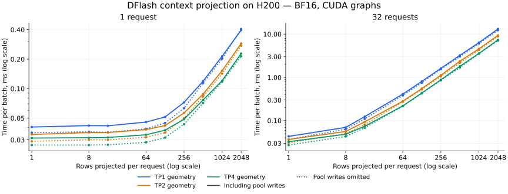

# DFlash context projection microbenchmarks

Measured on 2026-10-21 using `/tmp/autospec/baseline` and one NVIDIA H200.
For the planned peak of 32 active requests, rebuilding every full window is
substantial: approximately **7–13 ms per speculative round per rank**, compared
with **0.08–0.14 ms** for the current 16-row decode-block materialization path.
These are isolated projection timings, not complete serving-round timings.

The measurements support retaining bounded materialized draft KV for normal
decoding and using raw tails to rebuild it on reuse or invalidation. They do
not establish a throughput percentage: that requires measuring the serving
round, its overlap, and any benefit from additional target-cache capacity.



## What was measured

The benchmark loads the checkpoint's real BF16 weights. Synthetic contiguous
BF16 target features feed the existing production operations:

1. `DFlashDraftModel.project_target_hidden`: the replicated
   12,288-to-2,048 `fc` projection and hidden RMSNorm.
2. `FusedKVMaterializeHelper.materialize`: one stacked GEMM producing K/V
   for all six draft layers, followed by fused key RMSNorm and RoPE.
3. Six real writes into a token-major unified SWA view, using physical slot IDs
   and a page size of 16. An unused companion Full sub-pool satisfies the
   unified arena's construction contract; no target work runs.

Three timings are recorded for each shape: feature projection alone, feature
projection plus all context K/V without final pool writes, and the complete
path including pool writes. Omitting pool writes still produces all six layers'
K/V in the helper's temporary buffers; it is not an implemented attention path
without a persistent cache.

The primary sweep covers 1, 8, and 32 requests; 1, 8, 16, 64, 128, 256, 512,
1,024, and 2,048 rows **per request**; and TP1/TP2/TP4 geometry: 81 cases.
A confirmation run repeats the 8-, 16-, and 2,048-row cases at batches 1 and
32 and adds the real prefix-valid writer for a 16-row block committing 8 rows.

All TP cases run on a single GPU with rank zero's corresponding Q/K/V weight
shards. The context projection has no collective in this path, and `fc`
remains replicated. These are rank-local TP-shaped measurements, **not**
multi-GPU serving measurements or measurements with a separate TP1 draft
alongside a TP-sharded target.

Before timing, per-layer GEMMs and independent FP32 key norm/RoPE arithmetic
check the fused results and unified-pool contents, using BF16 tolerances of
`rtol=atol=0.02`. The checks run for every batch/TP fixture.

## Extension cost across lengths

TP1 medians from the primary sweep, including all context projections,
normalization, RoPE, and pool writes. Each cell is the time for the entire
batch; it is not divided by the number of requests.

| Rows projected per request | 1 request | 8 requests | 32 requests |
| --- | ---: | ---: | ---: |
| 1 | 0.041 ms | 0.042 ms | 0.043 ms |
| 8 | 0.042 ms | 0.046 ms | 0.070 ms |
| 16 | 0.042 ms | 0.052 ms | 0.124 ms |
| 64 | 0.046 ms | 0.125 ms | 0.411 ms |
| 128 | 0.051 ms | 0.212 ms | 0.810 ms |
| 256 | 0.072 ms | 0.432 ms | 1.618 ms |
| 512 | 0.119 ms | 0.823 ms | 3.238 ms |
| 1,024 | 0.214 ms | 1.710 ms | 6.375 ms |
| 2,048 | 0.396 ms | 3.210 ms | 13.159 ms |

The short-row cases are dominated by fixed costs and weight reads, so their
latency does not scale directly with row count. Full windows across many
requests introduce much more matrix multiplication and memory traffic.

An important correction to the illustrative “8 new rows” comparison: the
current overlap decode path passes **all 16 verify-input rows per request**
through projection, then masks the cache writes with `commit_lens`. An 8-row
benchmark represents a packed extension; it is not the current 16-row block's
projection cost when only 8 rows are committed.

## Compare normal decode with rebuilding every round

These medians come from the confirmation run. “Normal decode” projects 16
rows per request and uses the production prefix-valid writer to commit 8.
“Full rebuild, no pool write” projects 2,048 rows per request into temporary
K/V and skips the final six cache writes.

| TP geometry | Requests | Normal decode context work | Full rebuild, no pool write | Full rebuild, including pool write |
| --- | ---: | ---: | ---: | ---: |
| TP1 | 1 | 0.044 ms | 0.376 ms | 0.404 ms |
| TP2 | 1 | 0.038 ms | 0.267 ms | 0.279 ms |
| TP4 | 1 | 0.034 ms | 0.211 ms | 0.217 ms |
| TP1 | 32 | 0.138 ms | 12.320 ms | 13.320 ms |
| TP2 | 32 | 0.100 ms | 8.824 ms | 9.212 ms |
| TP4 | 32 | 0.077 ms | 7.000 ms | 7.094 ms |

Even skipping the final pool writes leaves roughly **90 times** the normal
context-materialization time at batch 32. This ratio applies only to the
measured context work, not to total inference latency.

The replicated feature projection limits the improvement from TP. At batch 32
and a full window, `fc` plus hidden RMSNorm alone takes approximately **5 ms
per rank**, before the six layers' K/V projection, norm, RoPE, or stores. The
two GEMMs require approximately

```text
2 × B × L × 12288 × 2048 × (1 + 1 / TP) FLOPs
```

At B=32, L=2,048, TP1 this is 6.60 TFLOPs per round, with 3.30 TFLOPs in the
replicated `fc`. The figures are arithmetic operation counts, not measured
hardware utilization.

For one request, the incremental cost of replacing normal context work with
full reprojection without pool writes is about 0.18–0.33 ms. Whether that is
acceptable depends on the complete serving round. At the requested peak of
32 requests, the measured extra context work is about 6.9–12.2 ms, so it
should not be treated as negligible.

## Could we remove the materialized draft cache?

Yes, the baseline can reconstruct context K/V from raw target features at
the current draft weights without replaying the target. Those projections
are pointwise in the target-context rows; the draft block's transformer and
convolution history does not need to be replayed over the context window.

That permits removing **persistence of draft context K/V across rounds**.
Attention still consumes K/V tensors during each forward, including the
current draft block. A viable implementation would provide transient context
K/V to attention and retain the raw-tail/checkpoint ownership and recovery
contracts. It would also need to preserve positions, window masking, and the
current weight revision.

The persistent draft window costs 48/24/12 MiB per request at TP1/TP2/TP4,
or 1.5/0.75/0.375 GiB for 32 requests, excluding temporary draft-block slots.
Raw tails remain necessary and cost 1.5 GiB per rank for 32 full windows.
The potential peak-memory saving is smaller than the removed persistent
allocation because reprojection needs working memory.

In particular, the current fused helper reserves both a stacked projection
buffer and separate all-layer K/V outputs. At 32 full windows, those two
buffers alone total **3 GiB at TP1**, before the projected features, raw tails,
or an attention output buffer. For 32 ordinary 16-row extensions they total
only **24 MiB**, alongside the 1.5 GiB persistent draft window. Simply removing
the final cache allocation and calling this helper on full windows would
increase this portion of peak memory. The benchmark intentionally preallocates
the helper's maximum workspace for stable timing; it does not measure serving
peak VRAM.

A memory-saving version could materialize one layer's context K/V, consume it
in attention, then reuse the scratch buffer for the next layer. That would
replace the stacked projection schedule and change both memory use and
performance. It is a separate implementation to measure; these results do not
claim its exact cost. The replicated full-window `fc` work would still remain.

Recommendation for the current design: keep materialized draft KV for active
requests. Reproject on cache reuse or invalidation, so the measured rebuild
cost is paid at those boundaries instead of every round. Before changing this
decision, compare complete serving runs, including acceptance, memory-driven
target cache hits, concurrency, and throughput.

## Measurement limits and reproduction

- H200, driver 610.57.04, PyTorch 2.14.1+cu130, CUDA 13.0, BF16 weights and
  features. GPU clocks were not locked; the reported power limit was 700 W.
- CUDA events measure warm graph replay, with four operations per replay to
  reduce Python launch effects. Each median summarizes seven groups of
  repetitions, each targeting at least 20 ms of GPU time. These are group
  averages, not request-latency percentiles.
- Inputs, positions, weights, workspaces, and pool storage are already on
  GPU. Timings exclude raw-tail collection/gather, host transfers, allocation,
  graph capture, scheduler/index construction, attention, the draft MLP and
  selector, and all target execution.
- Warm repeated buffers and an otherwise idle GPU favor reprojection. There
  is no measurement of overlap with target work or of its resource contention.
- Independent stage measurements can vary with clocks and kernel selection;
  do not subtract them to infer precise individual-kernel costs. For example,
  the primary single-request TP1 no-write median slightly exceeds its write
  median; the confirmation run gives 0.376 vs 0.404 ms. The full-window and
  incremental conclusions are stable across the two runs.
- No serving code or cache policy changed for this experiment. The manual
  benchmark reuses production operations and adds no kernels or CI jobs.

Use the checkout's CUDA-enabled Python environment:

```bash
PYTHONPATH=python python test/manual/kernels/benchmark/speculative/bench_dflash_context_projection.py \
  --model-path /tmp/autospec/baseline \
  --output /tmp/dflash-context-sweep.json

PYTHONPATH=python python test/manual/kernels/benchmark/speculative/bench_dflash_context_projection.py \
  --model-path /tmp/autospec/baseline \
  --lengths 8 16 2048 --batch-sizes 1 32 \
  --output /tmp/dflash-context-confirmation.json
```

The [saved measurements](draft-context-projection-benchmark.json) contain the
primary sweep and a separate `confirmation_run`, including every timing group.
The current script also measures prefix-valid decode writes during a default
sweep; that timing was added for the confirmation run after the primary sweep.
See the [benchmark source](../test/manual/kernels/benchmark/speculative/bench_dflash_context_projection.py)
and the [checkpoint design](draft-kv-checkpoint-design.md).
