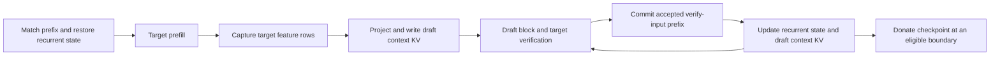
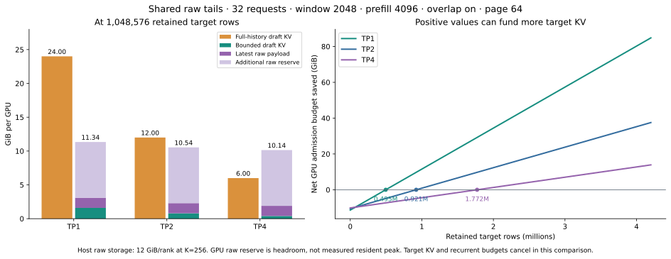

# Draft KV and recurrent checkpoint bundles for v1

Design proposal for review, based on the local SGLang checkout at
`6f168a98d8438f3cb8bfd7ecfbfd9c2efa15b5e2`, inspected on 2026-10-20. This document
extends the [v1 review](adaptive-spec-v1-review.md) and its agreed working rules.
Allocator, factory, draft binding, address translation, prefix-valid KV writes,
active feature-tail capture, host retention, checkpoint attachment, and
cache-hit restoration, opt-in serving construction, bounded allocation, and
memory admission are implemented. The serving path has been exercised on H200
at TP1 and TP2, including 32 active requests, CUDA graphs, and HiCache recovery.
The latest change shares overlapping raw-tail storage and tightens GPU admission
from 18.047 to 9.743 GiB per rank at the 32-request baseline. See
[the current memory bound and throughput results](#step-10-lossless-raw-tail-storage-and-tighter-admission).
See [implementation progress](#implementation-progress).

## Agreed recovery design

Agreed on 2026-10-21: retain raw target-feature tails with recurrent
checkpoints and active requests, and keep materialized draft KV in the bounded
unified SWA pool. Draft KV eviction or draft weight updates must not force
historical target replay, or shorten an otherwise usable target cache hit just
to recover draft context. The target still processes the uncached prompt
suffix normally. A complete retained bundle owns its recovery source.

The selected placement keeps active requests' latest raw tails on GPU and
offloads cached checkpoint tails to the HiCache host tier. Host capacity is
explicit and bounded; initial admission declines a new donation when full.
Factory sizing and GPU admission account for shared chunks, bounded transfers,
and the configured prefill ceiling; FA3 has been exercised end to end. The memory estimate below
uses 32 active requests and explicitly budgets recurrent state and cached
checkpoints; its original GPU-only comparison is followed by the host-placement
estimate.

The [context-projection microbenchmarks](draft-context-projection-benchmark.md)
measure the alternative of rebuilding draft KV every round. At 32 full windows,
the existing path takes roughly 7–13 ms per rank on H200 across TP4/TP2/TP1
geometry, compared with 0.08–0.14 ms for a normal 16-row decode-block extension.
These isolated timings support retaining the active materialized cache; they
are not an end-to-end throughput measurement.

Treat a reusable recurrent checkpoint as a bundle with enough draft context to
resume at **that exact token boundary**. The concern about long decodes is
correct: target attention KV and an end-of-prefix recurrent state cannot
regenerate earlier target hidden states. Keeping the latest checkpoint, or the
latest two nearby checkpoints, does not establish a sliding-window replay bound.

Bundling the checkpoint with its projected draft KV solves reuse at the same
draft revision. It does not solve invalidation after a draft weight update.
That requires either the original target features or an earlier recurrent state
from which to regenerate them.

For this baseline, **raw target features are the persistent draft context of
the bundle**, with projected draft KV treated as a derived cache:

```text
At prefix boundary C:
  existing target prefix identity and Full KV
  recurrent state S(C), including the target's convolution state
  raw target features for the draft window ending at C

For an active request:
  its latest raw target-feature window on GPU
  a bounded draft KV window materialized with the current draft revision
```

This gives a direct recovery path after draft KV eviction or a weight update:
reproject at most the required feature window under the current draft weights.
It needs **no target replay** for a complete bundle. A persistent projected-KV
copy can be added later if avoiding projection on cache hits justifies its cost;
I would not store both representations for every cached checkpoint initially.

This recommendation has a real memory cost. At TP1, a 2,048-token BF16 raw
feature window is 48 MiB, equal to this draft's KV window. At higher TP, a simple
replicated feature store is more expensive relative to sharded draft KV. An
earlier-checkpoint replay design is recorded below for comparison; it is not
the chosen recovery path because it spends target computation on old history.

For physical KV storage, the current recommendation is a **paged draft SWA
sub-pool within the unified byte budget**, with the same logical token IDs as
the target and an independent physical mapping. The native sliding-attention
layers define the window. The legacy compact-cache path is excluded from this
design. See [draft pool sizing and integration](#draft-pool-sizing-and-integration).

## Explicit opt-in for performance ablation

The entire smaller draft path is gated by **`--enable-dflash-swa-cache`**, which
defaults to `False`. It covers the separate draft SWA view, active GPU raw
tails, and cached checkpoint raw tails. Native sliding-attention layers,
unified memory, or HiCache alone must not select it.

The initial host-backed implementation requires both
`--enable-unified-memory` and `--enable-hierarchical-cache`, with the DFLASH
algorithm. Raw-tail host attachment now checks the opt-in and HiCache setting
explicitly; previously it was controlled only by injecting the host pool.
There is no implicit GPU-only fallback for cached raw tails without HiCache.

| New flag | HiCache | Behavior |
| --- | --- | --- |
| Omitted | Off or on | Existing draft storage path; no new raw-tail storage or transfers. |
| Enabled | Off | Configuration error: this implementation requires host retention. |
| Enabled | On | Selects the bounded draft view, raw GPU working set, and bounded host checkpoint pool, subject to model requirements. |

If the flag reaches a DFlash worker without the separate draft pool, startup
fails explicitly instead of silently running the baseline. Factory selection
uses this opt-in; compatible models are not switched automatically.
This feature currently selects Python TreeCore, while the ordinary path
defaults to Rust. An isolated cache-policy comparison should select Python
on both sides; the aggregate comparison below retains each path's default
selection and includes that backend difference.

The agreed throughput comparison uses **flag off with HiCache off** versus
**flag on with HiCache on**, retaining unified memory on both. The old fused
DFLASH + unified-Mamba placement rejects HiCache, so a strict one-flag toggle
would not start. This is not a blocker for the requested aggregate tokens/s
comparison. Step 10 records both configurations and a third control using the
pre-optimization feature-on implementation. It measures the combined feature
cost, including HiCache and TreeCore selection, rather than attributing the
difference solely to raw tail transfers.

## Inspected model and scope

The supplied `/tmp/autospec/baseline` contains `config.json` and
`model.safetensors`. I inspected the config and safetensors header without
loading the weights.

| Property | Baseline value |
| --- | --- |
| Architecture | `DFlash2DraftModel` |
| Draft layers | Six, all `sliding_attention` |
| Configured sliding window | 2,048 |
| Causality | `is_causal: false` |
| Draft block size | 16, including the anchor input |
| Hidden width | 2,048 |
| Attention geometry | 32 query heads, eight KV heads, head dimension 128 |
| Target feature taps in config | `[10, 15, 21, 26, 32, 37]` |
| Target feature width | 12,288; confirmed by `fc.weight` shape `[2048, 12288]` |
| Draft convolution | Kernel size two, group size 16 |
| Candidate selector | Rank 256, top-k 64 |
| Stored weight dtype | BF16 |

Two details matter for recovery:

- The [window resolver][window-resolver] converts the HF window to SGLang's
  `window_left`, so the configured 2,048 becomes **2,047 preceding positions**.
  The [FA backend][fa-window] applies a local window on both sides for this
  noncausal draft. The earliest draft-block query determines the oldest context
  row needed. Using 2,048 historical rows is a conservative storage contract;
  page alignment can require additional storage, without widening attention.
- The [grouped convolution][draft-conv] operates within the current draft block
  and masks taps across block boundaries. It is not applied to cached target
  context materialization. Its kernel size does **not** add a historical
  convolution halo to the raw feature window. The target's own convolution
  history is part of its recurrent checkpoint.

The local [benchmark][benchmark] pairs this baseline with
`Qwen/Qwen3.6-35B-A3B`, defaults to `extra_buffer_lazy`, and uses BF16. The cached
target config at
`/tmp/hub/models--Qwen--Qwen3.6-35B-A3B/snapshots/995ad96eacd98c81ed38be0c5b274b04031597b0/config.json`
has 40 text layers: 30 linear-attention layers and ten full-attention layers.
It has no target SWA layers and specifies FP32 recurrent state. I use that
pairing for the memory discussion. The draft directory does not contain a
target-identity manifest; this is corroborated configuration context, not proof
that the weights were trained against that exact target revision.

The proposed first scope is this text-only model pairing with a fixed target,
native recurrent checkpoint precision, and a fixed draft architecture, tap
layout, and window. Changes to target weights, adapters, position semantics,
or feature layout require a separate compatibility decision.

## What the current paths establish

| Statement | Finding |
| --- | --- |
| Smaller draft storage should be possible for an all-SWA draft. | Yes. Native sliding attention bounds the history that must remain readable; physical allocation must follow that lifetime to realize the saving. |
| Draft updates can invalidate projected KV. | Yes. Context KV depends on draft parameters. Raw target features remain reusable while the target and feature contract remain fixed. |
| Target KV alone is enough to recover missing draft KV. | No. The draft consumes selected target hidden states, not the target's attention K/V tensors. Recomputing them for a recurrent target needs an earlier state. |
| A checkpoint donated after a long decode may be insufficient for recovery. | Yes. It resumes computation after its boundary; it cannot rewind to the start of the preceding draft window. |
| Keeping two recurrent snapshots fixes that. | Not generally. Two recent snapshots may both lie after the needed replay start. Lazy tracking usually retains only one established checkpoint. |
| Bundling projected draft KV with the end checkpoint solves updates. | Only reuse at the same compatible revision. Old projected KV cannot generally be converted to new KV without features or replay. |
| A fixed cooldown establishes freshness. | No. Idle requests and persistent prefix entries need not advance during the wait. Explicit revision validity can replace that heuristic. |

I interpret “the next cache-hit request is less than the sliding window size”
as a hit followed by **fewer than one window of newly computed tokens**. That is
the important case: newly computed features cannot fill the whole context
window. If instead the new request diverges before the donated checkpoint,
there is also no usable state at that split unless an ancestor checkpoint
exists. The matcher already treats those cases differently from a Full-KV hit.

### Target computation and draft KV materialization

The main worker is [DFlashWorkerV2][worker]. The flow is:



1. **Prefill:** `forward_batch_generation` calls the target with full aux-hidden
   capture. It materializes every newly computed prompt row into draft KV
   before returning, because the scheduler can then insert the prefix into the
   radix cache. Cache-hit rows are not recaptured by this forward.
2. **Projection:** `_append_target_hidden_to_draft_kv_by_loc` calls
   `project_target_hidden`: `fc`, then `hidden_norm`. Each draft layer applies
   its K/V projection, K normalization, and positional transformation. The
   sequential and fused paths implement this materialization. See
   [the append path][worker-append] and [model projection][model-projection].
3. **Decode:** the draft proposes a block; the target verifies it. Only the
   committed prefix of **verify-input rows** becomes reusable context. The
   prefix-valid writer receives `commit_lens`; rejected suffix rows do not
   become committed draft context. The newly sampled bonus token has not yet
   been processed by the target and has no corresponding target feature row.
4. **Lifetimes:** the worker clears the returned hidden-state reference after
   materialization. Decode graphs share an aux output buffer that the next
   forward overwrites. A future feature store must copy or acquire owned
   storage before that reuse; retaining a Python tensor reference is not
   sufficient. See [the decode commit][worker-commit].

For this DFlash2 model, cached context rows are pointwise functions of the raw
target features and absolute positions. They are not produced by recursively
running the draft transformer over the historical prefix. Thus recovery from
raw features does not require six windows for six draft layers.

### Native attention and physical allocation

The baseline's six native sliding-attention layers determine which context
positions can be read. Pool allocation is a separate concern: the attention
mask alone does not reclaim physical rows outside that window.

The [pool configurator][pool-config] shares the target allocator with the draft.
A private draft pool must cover the target IDs, including the larger virtual
address space where applicable. Supported fused layouts instead put draft
rows inside target pool entries. Their allocation, movement, and freeing
follow the host entries. [Fused placement][fused-placement] also has backend
and host-window restrictions; it is not an independent draft-window allocator.

For the inferred target, Full KV plus recurrent state is the relevant cache
shape. Existing target-SWA machinery is useful precedent, but there is no
target SWA pool to shrink and directly reuse for this draft.

### Recurrent tracking, donation, and matching

- **Tracking grids:** prefill checkpoint depth uses
  `lcm(mamba_cache_chunk_size(), tree_page_size)`. Decode tracking additionally
  includes `mamba_track_interval`, whose default is 256. Use the resolved grid,
  not an assumed constant. See [grid definitions][grids].
- **Prefill tracking:** [extend preparation][extend-tracking] selects a
  snapshot produced by the backend, and can select a branching checkpoint.
  It does not retain an arbitrary rewindable history.
- **Speculative tracking:** [DFlash verification][verify-input] prepares Mamba
  tracking before constructing the forward batch. After acceptance,
  [the worker][worker-recurrent] commits the live state for the last committed
  verify input and can save a crossed tracking boundary from intermediate
  state. This is not a checkpoint per accepted token.
- **Lazy tracking:** [result processing][lazy-tracking] promotes a new keep
  slot and frees the previous one. Finishing requests can decline donation
  when the kept slot was, or may still be, written by an overlapped verify.
  Nonlazy tracking can retain a prior snapshot, mainly for correct finish
  handling.
- **Finish:** [MambaComponent][mamba-finish] chooses a checkpoint whose consumed
  token count fits the visible key. If the latest checkpoint overshoots a stop
  boundary, it uses an eligible previous checkpoint or donates nothing. It
  must never relabel a later state as an earlier prefix.
- **Insertion:** [checkpoint insertion][checkpoint-insert] takes the minimum
  effective cache length supplied by the components, inserts the selected
  state at that boundary, and transfers ownership. [Request release][release]
  frees the unprotected remainder. Thus Full KV through an arbitrary final
  output position is not automatically retained past the selected checkpoint.
- **Matching:** [the tree walk][match-walk] records both the Full-KV match and
  the deepest boundary satisfying all component validators. For Mamba, a
  reusable state must exist at that node. Splitting an edge does not synthesize
  an intermediate state. `mamba_branching_seqlen` identifies a possible future
  checkpoint; it does not immediately make that boundary restorable.
- **Eviction:** recurrent states can be evicted independently of Full KV.
  The optional per-path cap removes eligible shallow interior states while
  retaining Full KV. An older checkpoint observed once is not a retention
  guarantee. See [Mamba insertion, eviction, and splitting][mamba-lifecycle].

The existing [SWA retention floor][retain-floor] protects window rows behind
the last tracked recurrent checkpoint when a cache has both components.
The [SWA validator and insertion logic][swa-component] likewise require the
needed history and preserve the exact Mamba insertion boundary. These are
useful patterns for bundle ownership. They do not currently provide
revision-aware DFlash2 recovery for this Full-plus-recurrent target.

## A concrete long-decode failure case

Use half-open intervals. `S(C)` means the target state after processing tokens
`[0, C)`. Let `W = 2048` be a conservative historical storage window, and let
`N` be the next draft-block start, after the target has processed `[0, N)`.

Suppose:

```text
Older reusable checkpoint:       S(4096)
Long decode donates:              S(16384)
Next request extends that hit:    64 target tokens
Next draft block starts:          N = 16448
Conservative context required:    [14400, 16448)
Features produced by new prefill: [16384, 16448)
Missing historical features:      [14400, 16384)
```

`S(16384)` cannot regenerate the missing historical features. A prior
tracking snapshot at 16,128 is also too late. Even if Full KV is resident
through 16,384, that does not supply the missing feature rows or earlier
recurrent state.

If 4,096 is the only earlier usable checkpoint, replay to 16,448 requires
**12,352 target tokens**, far beyond a window. Capping prefix matching at
`N - W` does not create `S(N - W)`; the Mamba validator still falls back to an
actual ancestor checkpoint.

If the system deliberately retained a state on a 256-token grid immediately
before the recovery start, it would use `S(14336)` and replay **2,112 tokens**.
In general, with complete grid coverage and
`A = floor((N - W) / G) * G`:

```text
W <= N - A < W + G
```

The actual attention span is 2,047, so the minimal feature interval starts at
14,401 in this example; rounding to the same grid still yields 14,336. Page
and backend snapshot alignment must be included in any implementation bound.
A literal “at most 2,048 target replay tokens for every position” requires
stronger snapshot placement or some retained features; it does not follow
from ordinary checkpoint spacing.

The current full-sized draft pool usually avoids this recovery problem by
retaining draft rows with target allocations. This is a requirement exposed
by independent eviction and updates, not evidence that every current prefix
hit is already broken.

## Draft pool sizing and integration

This section addresses storage independently of the choice between raw feature
retention and recurrent replay for recovery. Both recovery designs can use the
same paged draft KV storage. The allocator, factory and serving integration are
implemented behind `--enable-dflash-swa-cache`.

### Separate lifetime, shared backing storage

“Separate pool” has two meanings here. Draft KV needs an independent allocation
and eviction lifetime. It does not need a separate fixed GPU allocation or a
separate request-to-token identity space.

The useful existing abstraction is:

```text
req_to_token[request, position] -> logical token v

  full mapping[v] -> target Full-KV physical page
  swa mapping[v]  -> draft SWA physical page, or absent

One physical byte budget:
  [ target recurrent states | draft SWA pages | target Full-KV pages ]
```

In [UnifiedSWAAllocatorBase][swa-allocator], Full owns the virtual page IDs and
SWA binds those same IDs to independently allocated physical pages.
`free_swa` removes the SWA binding and frees its physical page while leaving
Full KV and the logical ID alive. [KVIndexTranslator][kv-translator] already
separates Full and sliding-window address spaces. Thus a large logical target
prefix does not require an equally large physical draft pool. Mapping metadata
can still scale with logical capacity; the expensive KV payload need not.

[UnifiedKVPool][unified-buffer] provides one byte buffer with independently
managed sub-pools. The existing
[UnifiedMambaSWATokenToKVPoolAllocator][tri-allocator] already implements the
three-part state/SWA/Full arrangement. Its SWA middle region can move while
virtual IDs remain stable. Reuse that allocator behavior rather than building
another byte allocator for this feature.

### Draft-only SWA sub-pool integration

The [three-pool factory][tri-factory] accepts draft-owned SWA, with separate
model views. The [configurator][tri-configurator] selects this mode through
the explicit opt-in independently of the target's hybrid SWA classification.
A draft runner [binds the target-created draft SWA view][draft-binding].
The existing fused-draft binding puts draft lanes into host entries;
the new factory mode gives the draft its own SWA entries alongside this target's
ten Full-attention layers and 30 recurrent layers.

The engine's storage requirements should include both models:

| Sub-pool | Payload | Lifetime policy |
| --- | --- | --- |
| Full | Target's ten Full-attention layers | Target prefix retention |
| Mamba | Target's 30 recurrent layers | Active state and recurrent checkpoints |
| SWA | Draft's six attention layers | Live draft windows and speculative workspace |

The target remains a Full-plus-recurrent model. Do not set its model config to
hybrid SWA or fabricate a target attention layer to pass the existing factory
assertions. Target and draft also keep distinct model-layer namespaces and
buffer views; their layer IDs must not be merged into one routing table.

For this pairing, a draft-only SWA entry can use the draft's own six-layer MHA
geometry directly. Existing `MHASubPoolSpec` requires a positive layer count;
there is no need to represent the entry as a zero-layer target plus fused
draft bytes. The factory constructs that view and binds it to the shared
allocator. The draft configurator reuses that exact view after checking the
loaded draft's layers, geometry, dtype, and page size.

The implementation preserves these execution requirements:

1. Validate draft attention and direct target-feature materialization through
   the SWA address space. The translator now maps this single-pool draft's
   default IDs and explicit window IDs to the same SWA space. This supplies
   the correct addresses to default-space consumers such as `_draft_write_ids`;
   the writer is validated independently, and Step 9 qualifies FA3 execution
   with this pool arrangement at TP1 and TP2.
2. Commit accepted rows through the strided layout. Step 4 enables the existing
   [prefix-valid writer][prefix-writer] on the unified MHA view, using marked
   physical IDs. GPU tests cover its byte-copy and fused FP8 paths, including
   CUDA graph replay. The existing equal-width K/V restriction remains.
3. Let cache construction, admission, window eviction, and accounting see the
   draft SWA requirement even though the target has no SWA attention. Reuse the
   existing SWA component's lifecycle where its semantics apply.
4. Preserve the distinction between target-resumable, draft-ready, and
   draft-rebuildable cache hits. If raw features make an evicted draft window
   rebuildable, lack of materialized SWA must not unnecessarily discard the
   target hit. If no recovery source exists, that hit cannot immediately draft.

Step 9 connects construction, admission and active-window residency. The
existing fused-draft placement gates are preserved for the flag-off path;
the bounded draft uses separate SWA entries. Backend qualification beyond
FA3 remains separate work.

### Size physical occupancy by windows and work in flight

Let `F` be target Full-KV bytes per token, `D` draft KV bytes per token, `M`
bytes per recurrent slot, and `Nf`, `Nd`, `Nm` their live physical counts.

```text
Shared storage demand = Nf * F + Nd * D + Nm * M
                       + allocator/temporary reserves
```

For the BF16/FP32 assumptions in this document, at TP1:

```text
F = 20 KiB per target token
D = 24 KiB per draft token
M = 61.40625 MiB per recurrent checkpoint
```

The desired change is to stop charging `D` for every retained Full-KV token.
Raw feature retention remains an additional budget item if that recovery
design is selected; this equation covers the three KV/state sub-pools only.
`Nd` should cover the union of:

- Active requests' required context pages.
- Context pages deliberately held for cached recurrent checkpoints, if
  projected checkpoint windows are retained.
- Speculative block writes, pending overlap work, page rounding, and any
  checkpoint-relative retention lag.

Shared prefixes can share pages; cached checkpoints consume explicit cache
budget. The approximate private-window working set is concurrency times one
window, but that is not a hard capacity formula until the pending-write and
checkpoint-retention bounds are included. A speculative block can write beyond
the committed sequence while its earliest query still reads the old window.

With unified backing, sub-pools can reuse each other's available bytes within
the shared arena. Pool creation still fixes its total byte budget. Lower draft
occupancy frees capacity inside that arena; it does not return the preallocated
buffer's unused bytes to the GPU driver.

There are also per-side token limits. The current allocator's
[Full/SWA availability methods][swa-capacity] take the minimum of the configured
token allowance and the capacity physically schedulable in shared storage.
The [factory's sizing code][tri-sizing] explicitly retains these token counts
as conservation caps even when a profiled byte budget determines the arena
size. Thus shared backing does not automatically permit unlimited growth into
all unused bytes. V1 must make these limits, admission, and eviction agree with
the intended sharing policy. A chosen initial Full/SWA ratio is not a physical
partition of the arena, but sizing inputs can still constrain usable capacity.

A fixed separate paged SWA allocation could use the same logical mapping
contract, but would partition memory that the unified allocator can share.

**Prefill is part of sizing.** The ordinary SWA `alloc_extend` binds pages for
the whole extend. Releasing old pages afterward does not bound peak allocation.
DFlash materializes context pointwise after target prefill, so it can project
only the ranges needed for upcoming drafting and checkpoint retention.
Admission, SWA page binding, and materialization must agree on those ranges.
`alloc_extend_swa_tail` is an existing example of allocating Full for the whole
sequence and SWA only for its tail, but currently serves a single-request
decode-node preallocation path; it is not a ready-made batched DFlash prefill
solution.

This bounds draft KV residency; it does not by itself reduce the target's
prefill activations or the full aux-feature output currently captured.

### Comparison with a request-indexed ring

A request-indexed ring is a valid alternative, especially if projected KV is
only active working state and cache hits always rematerialize it:

```text
draft address = request_slot * ring_capacity + position % ring_capacity
```

It makes the per-request bound explicit and avoids per-token allocation in
steady-state decode. A simple preallocated implementation reserves space for
the configured request slots, including unused slots. It also requires
ring-aware read indexing, wraparound handling, and enough slack that draft
block writes cannot overwrite rows still needed by the current attention.

SGLang has [request-indexed SWA rings for DeepSeek/DSpark][request-rings], but
their addressing and workspace assumptions are specific to those paths; they
are not a general DFlash ring implementation.

| Concern | Request-indexed ring | Paged SWA in unified storage |
| --- | --- | --- |
| Active decode allocation | Fixed capacity per admitted request | Pages allocated and recycled as the window advances |
| Prefix sharing | Normally copy/rematerialize into each request's ring | Shared logical prefix pages can reuse the same draft payload |
| Checkpoint donation | Copy out the window or retain its request-owned storage | Retain page references under checkpoint/cache ownership |
| Unused capacity | Fixed rings reserve it; dynamic window allocation needs additional policy | Shared byte accounting and eviction reclaim it |
| Addressing integration | Add ring-aware draft reads and writes | Extend existing SWA translation and writer paths |
| Weight-update recovery | Requires features or replay | Requires features or replay |

Prefix sharing can substantially reduce the **live draft working set**, but it
does not establish a smaller worst-case capacity requirement. For example,
32 active requests resuming from the same prefix boundary and draft revision
can share one materialized 2,048-token context window. With this baseline at
TP1, that is about 48 MiB of shared context instead of 32 private copies totaling
1.5 GiB. Both designs still need room for private continuations, speculative
writes, and page or ring slack. This example excludes checkpoint storage and
metadata.

A high cache-hit rate alone does not imply this saving. Hits must share pages
within the windows currently needed by the draft; different prefixes or
requests that have diverged by a full window have independent working sets.
With disjoint windows, both designs need roughly concurrency times window size
in active context storage. Retaining additional inactive checkpoint windows
can increase paged storage beyond an active-only ring's working set, so that
retention needs its own eviction policy.

The working direction from discussion is to reuse paged SWA in unified storage.
It preserves useful prefix-sharing and checkpoint lifetimes without making a
cached checkpoint occupy a request slot. The smaller live footprint can serve
more concurrent work within the same byte budget, subject to the configured
limits, or justify a smaller budget for a specified workload. Capacity planning
must still allow the required concurrency when windows do not overlap.

The agreed arrangement uses the paged pool for materialized draft windows and
retains raw features with recurrent bundles to recover independently evicted
or invalidated draft KV.

## Bundle contract

### Identity, boundary, and contents

Use the existing radix identity, including its token prefix, adapter/extra key,
and cache salt. Associate the bundle with a target/feature compatibility epoch
owned by the engine. Avoid duplicating the prefix tokens or independently
maintaining another prefix hash when the tree already owns that identity.

A complete bundle at `C` consists of:

| Part | Required invariant |
| --- | --- |
| Target Full KV | The target prefix required to resume computation is retained by the existing cache ownership. |
| Recurrent checkpoint | Contains all recurrent and target-convolution state after exactly `[0, C)`. |
| Raw target feature tail | Covers `[max(0, C - W), C)`, or an explicitly page-rounded superset, in the expected tap order and dtype. |
| Optional materialized draft KV | Names its draft revision, positions, and valid range; usable only when all match the current draft context contract. |

The raw features must precede `fc` and `hidden_norm`. Saving only the
2,048-dimensional projected features would be cheaper, but an update to those
projection parameters would invalidate them too. Freezing those parameters
would be a separate training restriction; it should not be an accidental
cache requirement.

Use one compatibility/revision value for the whole published materialized
window. Initially invalidate it on every successful draft weight update.
Parameter-specific invalidation is an optimization to consider after the
basic lifecycle is correct.

### Capture and publication

Copy raw features at the two existing materialization sites: target prefill
and the committed prefix of target verification. Reuse the existing
`commit_lens`, positions, and allocation information. Avoid a second
acceptance calculation or a second interpretation of token offsets.

Track the active feature tail independently of the training capture pipeline.
Training queues may drop, delay, or backpressure records; serving recovery
must not depend on whether the trainer consumed a sample.

When an eligible recurrent state is donated, publish its feature tail with it.
The pair becomes matchable only once both are ready. Preserve existing stream
ordering and completion rules: a scheduled copy is not yet a completed
ownership transfer, especially with overlap scheduling.

Deduplication must choose a complete canonical bundle. If insertion finds an
existing complete bundle for the same boundary, retain it and release the
unused candidate's resources together. Do not independently choose a state
from one producer and a feature tail from another. A tree split leaves the
bundle at its original end boundary, just as it currently leaves Mamba state
on the child.

**The retained tail must end at the selected checkpoint, not the current
request length.** If live computation has advanced from `C` to `T`, retaining
only `[T - W, T)` can already have destroyed part of `[C - W, C)`. This is the
same boundary problem for raw features as it is for projected KV.

For a simple first implementation, retain enough request-owned feature history
for the checkpoints that remain eligible for donation, and copy the selected
window into immutable bundle storage on donation. The source retention floor
must follow the oldest eligible checkpoint, including an eligible previous
checkpoint after stop trimming. Derive capacity from the real snapshot and
overlap bounds; do not allocate exactly `W` and assume it is enough.

If a large prefill would overwrite a selected earlier branching window before
donation, preserve that slice directly from the current prefill features.
Copying only the final tail of every forward would be incorrect. If the
selected checkpoint's window crosses a prefix-cache boundary, combine the
restored bundle tail and newly computed rows.

Copying windows at each donation has bandwidth cost. Step 10 implements shared
immutable GPU chunks within the request/checkpoint ownership model, avoiding
whole-window snapshot copies without a second cache index or page allocator.
The original copied-window approach remains documented in Steps 5–9.

### Restore and partial matches

On a hit at `C`, restore the target recurrent state through the existing COW
path and acquire the feature tail before allowing its cached owner to be
released. Compute the uncached target suffix normally. Before the first draft
block at `N`, assemble the required feature interval from cached and new rows
and materialize draft KV under the current draft revision.

If at least a whole required window was newly computed, the old draft tail is
not needed for that block. If fewer tokens were computed, the corresponding
tail of the bundle supplies the gap. Admission can initially require complete
bundles uniformly; skipping unnecessary tail work is a later simplification
only when its callers prove full new coverage.

A partial hit inside an edge carrying `S(C)` cannot reuse that state at a
smaller boundary. Use an earlier complete bundle and the existing target
prefill path. Never truncate a bundle's key while leaving its recurrent state
unchanged.

The guarantee is conditional on a **complete bundle hit**. A genuine cache
miss can still require a long target prefill. Bundles cannot guarantee bounded
replay for arbitrary prefixes whose states and features were evicted.

### Eviction and allocation

Keep three lifetimes explicit:

1. Existing target Full-KV ownership, potentially much longer than a window.
2. Recurrent checkpoint plus its persistent raw feature tail, acquired and
   evicted as one restorable unit.
3. Materialized draft KV, independently reclaimable and reproducible from the
   feature tail for the current revision.

When raw bundle storage is reclaimed, invalidate/evict the corresponding
recurrent cache entry through the existing component lifecycle. Full KV may
remain, as it already can after Mamba eviction. Do not leave the state
advertised as a complete draft-resumable hit after freeing its required tail.

Active requests must hold their required features and any in-flight buffer
leases. Reserve their bounded working storage at admission. Under pressure,
evict inactive bundles or use the established scheduling/retraction policy;
silently dropping the recovery source from an active request breaks the
guarantee.

A physically smaller draft pool needs draft-owned slots and read/write
locations. Shared virtual token IDs can remain the request/tree identity while
the draft SWA mapping selects independently allocated physical pages. Both
attention reads and direct materialization writes must use that mapping.
Never shrink the buffer while continuing to index it directly with target
global IDs.

Budget active draft windows, the speculative block's temporary rows, page
rounding, and overlap lifetimes. Persistent raw bundle storage needs its own
explicit budget. “Bounded per window” does not mean total memory is independent
of concurrency or the number of cached checkpoints.

## Weight updates without a cooldown

The future update path should establish freshness at an execution boundary:

1. Prepare and validate the new weights outside the serving commit boundary.
2. At a safe boundary, finish old in-flight draft readers, commit the new
   weights on all participating ranks, and refresh derived projection/selector
   state that the current execution path actually uses.
3. Advance the serving draft revision. All older materialized windows become
   invalid by revision comparison; raw feature bundles stay valid because the
   target did not change.
4. Before each affected request's next draft block, rebuild its required KV
   window from raw features using the new weights. Rebuild idle/cached entries
   when used, rather than eagerly projecting the entire prefix cache.
5. Publish the new valid range and revision only after the writes are ready.
   No draft forward may mix old context KV with a window labeled new.

This removes the need to wait for old entries to age out. It still has bounded
rematerialization cost, and draining in-flight work has a latency cost; neither
should be called free. If another update arrives before an idle request runs,
it can rebuild directly for the newest committed revision.

The update ACK can mean “weights committed; future draft execution enforces
the new revision,” without requiring all idle windows to have been rebuilt.
Make that contract explicit when designing the endpoint. The current checkout
does not contain v0's `/update_draft_weights` endpoint; this is a v1 proposal,
not a description of an existing operation.

Removing the cooldown does not make an entire ongoing request a product of
one draft revision. Its earlier tokens may have been proposed with previous
weights. Future capture should identify the revision of each draft/verify
record and retain the existing target-feature identity discipline. Rebuilding
KV addresses cache freshness; it does not erase request history.

## Considered alternative: retain earlier recurrent states and replay

This alternative is not selected: avoiding extra historical target execution
is an explicit throughput requirement. The following records its tradeoffs.

If feature memory is too expensive, a bundle at `C` can instead keep:

- Its normal end state `S(C)` and optionally the same-revision draft KV window.
- A recovery state `S(A)` early enough to regenerate the needed history.
- The token/position information and target Full-KV prefix needed to run from
  `A`, with ownership protecting all dependencies.

For a block starting at `N`, require `A <= N - W` and a proven maximum for
`N - A`. The seed must be on the same token branch; a checkpoint from another
continuation is not interchangeable.

Three obligations make this larger than attaching a pointer to the latest
snapshot:

1. **Creation and retention during decode.** For a `W + G` bound at arbitrary
   invalidation positions, checkpoints must remain available at the required
   grid points approximately one window behind the live frontier. With
   `W = 2048` and `G = 256`, this generally retains about nine historical grid
   states per active branch, plus live/in-flight requirements. The usual
   latest/previous slots do not provide that history. Coarser seed spacing
   reduces memory but permits more replay; spacing of a window gives a bound
   approaching two windows.
2. **Donation and lifetime.** An end bundle must preserve its older recovery
   seed when the request finishes, even if the ordinary Mamba LRU or per-path
   cap would otherwise remove that seed. The seed cannot be assumed to remain
   because it is an ancestor.
3. **Replay execution.** Replaying a cached suffix must not overwrite shared
   target KV or replace the live recurrent state with scratch replay state.
   It needs safe scratch writes, COW state, absolute positions, and target
   feature capture. Approximate/quantized checkpoints and different prefill
   kernels can also change replay numerics; numerical parity needs validation.

An anchor fixed for one bundle may be adequate for a short continuation, but
does not maintain the bound forever as a request decodes. A moving seed policy
is required. The bound must distinguish ordinary computation of new tokens
from additional historical replay.

I would choose this design only after comparing the state-memory and replay
costs with feature retention at the intended TP and concurrency. It is a
reasonable option, but it requires more changes to checkpoint tracking and
execution than rematerialization from already captured target features.

## Memory comparison for this model

These are tensor-payload estimates, not measured pool allocations. They assume
BF16 features and draft KV, native FP32 target temporal state, BF16 target
convolution state, and normal head sharding. They exclude page padding,
allocator metadata, temporary verify state, and overlap buffers.

```text
Draft KV per token, TP1:
  6 layers * 2 (K,V) * 8 heads * 128 dimensions * 2 bytes = 24,576 bytes

Raw target features per token:
  6 taps * 2,048 dimensions * 2 bytes = 24,576 bytes

One target recurrent checkpoint, TP1:
  30 layers * [32 * 128 * 128 * 4 + 8,192 * 3 * 2] bytes
  = 61.40625 MiB
```

The target state estimate follows [its cache shape construction][target-state]
and [state dtypes and dimensions][state-shapes]. Raw features are assumed
replicated at each draft runner, matching a straightforward use of the
12,288-wide inputs to the replicated context projection.

| Payload per GPU | TP1 | TP2 | TP4 |
| --- | ---: | ---: | ---: |
| Draft KV for 2,048 tokens | 48 MiB | 24 MiB | 12 MiB |
| Raw features for 2,048 tokens, replicated | 48 MiB | 48 MiB | 48 MiB |
| One native recurrent checkpoint | 61.406 MiB | 30.703 MiB | 15.352 MiB |

At TP1, shrinking draft KV associated with a 32,768-token private history from
768 MiB to a 48 MiB active window is substantial. Adding a 48 MiB raw tail
still leaves 96 MiB for these two active payloads, before retention slack and
cached bundles. This is an illustrative per-sequence comparison: shared
prefixes and allocator capacity determine the actual engine saving.

Conversely, 128 independent raw checkpoint tails already cost 6 GiB per rank.
Retaining both raw and materialized tails for every cache entry doubles the
context payload at TP1. Feature storage therefore needs a budget tied to
checkpoint retention, and checkpoint count must remain visible in memory
accounting.

At higher TP, a replay seed becomes cheaper relative to replicated raw
features. But a dense active history of nine native states would be roughly
553 MiB at TP1 or 138 MiB at TP4, before live state and scratch replay storage.
Do not compare a full feature-retention design with only one replay seed while
omitting the active checkpoint history needed to guarantee its placement.

Sharded/compressed features, shared feature pages, cached projected windows,
or coarser replay guarantees are later tradeoffs. They should not be bundled
into the first correctness feature.

### Budget for 32 active requests

Use the [interactive memory comparison](draft-kv-memory-budget.html) to vary
the target-token footprint, TP, persistent Mamba slots, and temporary reserves.
The defaults below are an estimate for review, not launch settings or a
measured GPU-memory peak. They use the same TP for target and draft and exclude
HiCache, DCP, PP, checkpoint quantization, and ReplaySSM. The source geometry
comes from the supplied draft and the inspected target config.

The interactive calculator and figure now use the Step 10 shared-tail storage
and GPU admission reserve. The original estimates below remain as design history;
their copy-count assumptions are not the implemented reservation.



Define the following counts separately:

- `A = 32`: active requests.
- `K`: planned persistent Mamba slots, including live states, tracking slots,
  cached recurrent checkpoints, and COW/admission headroom. This is not simply
  the number of idle prefix-cache entries.
- `T`: unique target Full-KV token rows retained across active requests and
  the prefix cache. Shared prefixes count once. `T / A` is only an equivalent
  per-request length, not necessarily the actual prompt length.
- `J`: extra full raw-tail copies simultaneously in flight. The illustration
  reserves 32; this is a budgeting assumption, not a proved lifecycle bound.
- `E`: draft KV rows per active request beyond the 2,048-row window. The
  illustration uses 64 for speculative writes, overlap, and page slack; the
  final allocation bound must be established when wiring that lifecycle.

The local benchmark defaults to `extra_buffer_lazy`. With overlap on and the
default decode-lock policy, the [existing admission calculation][mamba-ratio]
reserves **four persistent state slots per active request**: 128 for 32
requests. This includes COW/cache headroom and is not a claim that every
request always owns four filled snapshots. Nonlazy `extra_buffer` with overlap
reserves five, or 160 slots. The optional decode-lock skip changes these
factors; the calculator exposes the corresponding lazy factor of three.

For illustration, `K = 256` leaves 128 slots beyond the lazy active-request
reservation for retained checkpoints. In unified storage, this is a planned
simultaneous state demand/budget; sub-pool maximum view capacities overlap and
must not be added as if they were separate allocations.

Budget **one independent raw window per planned persistent state slot** for
the first comparison: `48 MiB × K` per rank. This includes active tails and
the windows belonging to tracked/cached checkpoints. It is conservative when
slots are empty or several owners share a complete bundle. Actual feature
pool allocation and sharing are not implemented by this estimate.

This is not a requirement to allocate a tail for every physical Mamba slot.
Recovery needs feature coverage for each retained, reusable checkpoint boundary
and each active request; empty reservations and speculative scratch states do
not independently need tails. The example reserves 256 raw windows, not only
the 32 active windows. The separate 32-window copy allowance is temporary.

| Planned K | Slots beyond the 128-slot active reservation | Raw-tail budget per rank | Persistent state payload at TP1, excluding padding |
| --- | ---: | ---: | ---: |
| 128 | 0 | 6 GiB | 7.676 GiB |
| 192 | 64 | 9 GiB | 11.514 GiB |
| 256 | 128 | 12 GiB | 15.352 GiB |
| 512 | 384 | 24 GiB | 30.703 GiB |

Persistent state payload divides by TP1/2/4; the straightforward replicated
raw store does not. Cached chunked-prefill checkpoints consume these same
persistent slots and raw-tail windows. Do not count them again in another
pool, or omit them by sizing only 32 live states.

The current [unified Mamba pool][unified-mamba-scratch] also allocates full
speculative intermediate SSM and convolution buffers outside the shared arena.
At block size 16 and 32 active requests their payload is
`(32 + 1) × 16 × state_bytes`: **31.663 / 15.831 / 7.916 GiB per GPU at
TP1 / TP2 / TP4**. The extra one is the padding request slot. These buffers
exist in both sides of this comparison, so they cancel in the net saving but
must remain in the absolute budget. The unified pool currently uses dense
convolution intermediates and does not support ReplaySSM; the generic pool's
convolution deduplication must not be assumed here. A metadata-only construction
of the real unified pool verified these buffer sizes without allocating their
payload on a GPU.

For chunked prefill, a forward producing `P` captured feature rows has
`P × 24 KiB` of raw feature-output payload: 8,192 rows are **192 MiB per rank**.
This output already exists for draft materialization and is separate from the
new persistent tail copies. Temporary recurrent kernel states also need
headroom: for example, the [Triton GDN chunk path][prefill-h] allocates one
BF16 state per 64-token kernel chunk for the current layer. At TP1 that is
1 MiB per chunk, roughly 128–159 MiB for 8,192 tokens split over up to 32
requests. This is not 30 simultaneously persistent checkpoint copies. Other
prefill backends, activations, graph pools, and kernel workspaces require a
real peak-memory run; the calculator does not pretend these are captured by
the persistent-state count.

### Net saving and additional target-KV capacity

Compare against an idealized full-history draft pool containing one draft KV
row per retained target token. The legacy compact path is excluded. A current
private draft pool spanning a larger virtual-ID space can cost more than this
baseline. The baseline does not provide the new weight-update recovery
contract; storing raw tails pays for that additional capability.

Let `R = 24,576` be raw-feature bytes per row, `W = 2,048`, and
`D = 24,576 / TP` be draft KV bytes per row. For this target,
`F = 20,480 / min(TP, 2)` is Full-KV bytes per row: it has only two KV heads,
so [KV head replication][kv-heads] makes TP4 cost **10 KiB**, not 5 KiB,
per target token per GPU.

```text
Old draft payload       = T × D
New draft payload       = A × (W + E) × D
Raw tails + copy reserve = (K + J) × W × R
Net bytes freed         = old draft − new draft − raw tails − copy reserve
Extra target-token rows = net bytes freed / F
```

Target Full KV and the recurrent-state budgets are held fixed. The target
does not use fewer bytes per token; the net freed budget can hold more target
tokens. More target tokens are possible only while the fixed checkpoint/tail
budget remains sufficient. Negative values mean the new design needs more
memory at that footprint.

For **A = 32, K = 256, T = 1,048,576** (32K retained rows per active request
if divided evenly), with **J = 32, E = 64, P = 8,192**:

| GiB per GPU | TP1 | TP2 | TP4 |
| --- | ---: | ---: | ---: |
| Target Full KV, both designs | 20.000 | 10.000 | 10.000 |
| Persistent recurrent states, including one padding slot, both designs | 15.412 | 7.706 | 3.853 |
| Speculative state workspace, both designs | 31.663 | 15.831 | 7.916 |
| Prefill feature output, both designs | 0.188 | 0.188 | 0.188 |
| Old full-history draft KV | 24.000 | 12.000 | 6.000 |
| New active draft KV, including E | 1.547 | 0.773 | 0.387 |
| New raw feature tails | 12.000 | 12.000 | 12.000 |
| New temporary tail-copy reserve | 1.500 | 1.500 | 1.500 |
| **Net cache bytes freed** | **+8.953** | **−2.273** | **−7.887** |
| **Equivalent additional target-token rows** | **+469,402** | **−238,387** | **−827,187** |

The selected component totals are 91.262 → 82.309 GiB at TP1,
45.725 → 47.998 GiB at TP2, and 27.956 → 35.843 GiB at TP4. These exclude
weights and the other workspaces noted above; they do not establish that this
configuration fits on a particular GPU.

Without temporary/page allowances (`J = E = 0`), break-even is
`T = A × W + K × W × TP`: **589,824 / 1,114,112 / 2,162,688** retained
target rows at TP1 / TP2 / TP4 for K=256. The illustrated reserves raise these
to **657,408 / 1,247,232 / 2,426,880**. This is why smaller materialized draft
KV is not automatically a net memory win. Retained checkpoint count and
replication of raw features are first-order terms in capacity planning.

The calculator's cache storage is GPU resident. No disk storage is required
by the agreed recovery contract; training datasets and model checkpoints are
outside this estimate. Host offload, feature sharding/compression, and shared
feature pages are possible future optimizations, not assumptions hidden in
these numbers.

### Raw-tail retention versus GPU residency

Keeping only the latest tail is sufficient for an active request's current
boundary, subject to in-flight capture lifetimes. It does not preserve older
cached checkpoints: a later window generally lacks the beginning of an earlier
window. Branching requests can resume at those earlier boundaries. Each
checkpoint offered for recovery without target replay therefore needs its
feature interval retained somewhere; independent copies are not mandatory if
overlapping intervals or identical bundles share storage. A continuation that
computes an entire new window can make the old tail unnecessary, but arbitrary
short continuations cannot rely on that.

Agreed placement: **active tails on GPU, cached tails on host**. Maintain the
active window locally, offload selected checkpoint tails, and load the selected
tail when a cached prefix is reused and its draft context needs reconstruction.
GPU memory scales with active windows plus bounded capture/load staging; host
memory scales with retained cached tails.

There are two independent reasons to reconstruct draft context: the relevant
materialized KV was reclaimed, or its draft revision is stale. A weight update
is not required for the first case. Initially, materialized KV is retained for
active windows, not for every cached checkpoint. A later request can therefore
hit a target/recurrent checkpoint whose draft KV was released when its donor
finished or advanced beyond that window.

| Situation | Raw-tail location | Draft context action |
| --- | --- | --- |
| Active request, compatible materialized window | GPU | Continue with existing KV and append new context normally. |
| Active request after a draft update | GPU | Reproject the resident tail before the next affected draft forward; no host load. |
| New request hits a cached checkpoint whose materialized window is absent or stale | Host, unless already resident through another owner | Load the required features and project with the current draft weights, even if those weights have not changed since checkpoint capture. |

For example, request A finishes at boundary C and retains a checkpoint with a
host raw tail; its active draft KV is released. Request B later matches C.
Restoring B's draft context needs that tail even without an intervening update.
Target processing still starts at C for the uncached prompt suffix. If a full
window of new target features replaces the old context before drafting, the
historical tail is unnecessary. A future cache of materialized checkpoint
windows could also skip projection when a compatible complete window remains
resident; the initial memory budget does not assume such a cache.

The alternative of keeping all tails on host remains deferred. It would stream
newly committed feature rows to host and load active windows for reconstruction,
saving persistent GPU storage at the cost of additional transfers. Any such
implementation must preserve snapshots across asynchronous copies and
source-buffer reuse, copying new rows rather than a full window per decode step.

For an illustrative 256 distinct windows, placing 32 active windows on GPU and
224 cached windows on host changes raw-tail residency from 12 GiB on GPU to
**1.5 GiB on GPU plus 10.5 GiB on host per rank**. Keeping a canonical host copy
of all 256 would instead use 12 GiB on host, alongside the GPU working set.
Neither estimate assumes deduplication across TP ranks. Holding the earlier
temporary reserve and every other budget fixed, the first option changes net
GPU bytes freed at the 1,048,576-token footprint to **19.453 / 8.227 / 2.613 GiB
at TP1 / TP2 / TP4**. These are historical placement estimates, not implemented
bounds or measured transfer performance. The calculator now uses Step 10's
GPU admission reserve and reports host storage separately.

Draft updates leave raw tails valid while the target and feature definition
remain unchanged. Rebuild active materialized windows for the new revision;
leave idle tails on host until used. With all active tails offloaded, restoring
32 full windows transfers 1.5 GiB per rank before accounting for any already
staged data. Advance notice of an update can help schedule transfers, but
active boundaries continue moving: prefetched data must include subsequent
committed rows. Likewise, prefix matching can start a load that may overlap
the new target-prompt extension; zero added latency is not guaranteed.

The existing [HiCache host-pool group][host-pool-group],
[asynchronous transfer engine][l2-transfers], and
[Mamba component transfer lifecycle][mamba-transfers] provide integration
boundaries. Step 6 adds a bounded raw-tail host pool using the transfer engine;
step 8 connects checkpoint attachment, matching, and restoration. Step 9
connects factory construction and sizing.
In particular, Mamba load-back returns no transfer when its device state is
already resident; a host-only feature tail must still load in that case.
Logical checkpoint ownership must therefore be preserved while allowing
independent tail residency. Keep the source leased until backup completes,
wait for the selected tail before draft reconstruction, and reclaim the
recovery source only with the corresponding bundle's eligibility. The first
placement option is selected and avoids a host round trip for active-request
draft updates; full host residency remains a later option to evaluate against
measured transfer cost.

## Implementation progress

Steps 1–9 below record the scope and validation at each review boundary.
References to pending integration describe that step's state. Step 9 completes
serving integration; Step 10 replaces its ring/snapshot representation and
initial raw-memory bound.

### Step 1: Separate model views in the existing allocator

Implemented for review on 2026-10-20. The existing
[tri-pool allocator][tri-allocator] now accepts an optional `swa_kvcache` view.
This lets the target keep its `UnifiedHybridLinearKVPool` while a draft owns
the SWA view of the same `UnifiedKVPool`. Full remains the owner of logical
token IDs. The existing SWA allocator owns its physical bindings, reclamation,
and relocation; the allocator's `get_kvcache()` still returns the target view.
Constructor validation rejects a view of another buffer, another sub-pool, or
a different page size.

The [new allocator tests][test-separate-draft-swa] use real CPU buffer views
with separate model-layer namespaces, different target/draft head geometry and
dtypes, and both convolution and recurrent state. They exercise SWA eviction
and rebinding, Full compaction, SWA relocation, and final release at page sizes
1 and 4. Remaining KV rows must match exactly and target state must survive.

Validation: 53 tri-pool tests, two shared-virtual-ID tests, and one SWA-tail
allocation test passed in the local environment with PyTorch 2.14.1+cu130.
The new cases failed before the constructor extension. Formatting, import
ordering, focused lint, and whitespace checks passed. No inference or attention
kernel validation is claimed for this step.

Minimization kept the production change in the existing allocator module:
one optional view argument, no new allocator class, persistent ownership flags,
or scheduling policy. Step 2 adds factory construction. Runtime sizing/admission,
runner translation, and DFlash writes still need integration before serving
can use this path.

### Step 2: Construct draft-only SWA in the shared factory

Implemented for review on 2026-10-21. The existing
[Full/SWA/state factory][tri-factory] accepts `draft_swa_layer_ids` and
`draft_kv_cache_dtype` together. Its existing SWA head geometry and window
arguments then describe the draft. The target SWA layer list must be empty;
combining this mode with fused draft placement is rejected.

The returned `UnifiedPoolBundle.draft_token_to_kv_pool` is a view of the shared
SWA sub-pool. The target retains `UnifiedHybridLinearKVPool` and the same
recurrent pool as the request table. Target global layer IDs map to compact
Full-KV indices; the draft has its own contiguous layer range and dtype.
Neither model's layer offset is applied to the other model's view.

The existing byte-budget calculation now prices draft SWA from its own row
geometry and token capacity. A supplied profiled token-byte budget remains the
shared token budget, with recurrent-state bytes added as before. Full and draft
host-capacity accounting uses each sub-pool's own entry size. The factory also
wires the target's recurrent-state translation through the shared slot allocator.

Validation: 56 tri-pool tests, six state-wiring/staging tests, and the existing
CPU convolution-compaction test passed, totaling 63 tests. The three new
[factory cases][test-draft-swa-factory] failed before the extension. They cover
overlapping model-layer IDs with independent offsets, different dtypes and K/V
head widths, page sizes 1 and 4, both byte-budget modes, smaller draft token
capacity, and invalid ownership combinations.

The minimization pass kept construction in the existing factory and reused its
budget, state-pool, and allocator setup. No new pool class or configuration flag
was added. Runtime selection and deriving capacity from the model pairing remain
pending. Step 3 connects draft-runner binding and address translation first;
execution stays on the existing path until writes and admission are integrated
and validated.

### Step 3: Bind the draft view and translate its addresses

Implemented for review on 2026-10-21. This review unit was narrowed from automatic
pool selection to binding and addressing so it does not choose a capacity,
retention policy, recovery representation, or initial attention backend.

The allocator exposes its separate draft SWA view through
`get_draft_swa_kvcache()`, derived from existing pool ownership. The
[draft configurator][draft-binding] reuses that view, the target request table,
and the allocator. It rejects a mismatched page size, dtype, layer IDs, KV head
geometry, full-attention or recurrent layers, a second draft runner, and a
missing shared request table. It does not allocate another KV buffer.

[KVIndexTranslator][kv-translator] recognizes the exact allocator-owned draft
view. Its default `FULL` selector means the single pool's own token IDs; for
this view, both that selector and `SLIDING_WINDOW` resolve to SWA physical IDs
and share one plan-cache key. The target keeps its Full mapping. The
[iteration plan][plan-ownership] recognizes their shared logical ID ownership
through the common SWA space, allowing either runner to build the plan while
preserving virtual IDs for bookkeeping. Unrelated allocators and unbound views
do not acquire this translation merely by sharing a request tensor or byte buffer.

The three new [binding/translation tests][test-draft-swa-binding] cover page sizes
1 and 4, both plan-building directions, distinct target/draft addresses, shared
write and read-table results, missing SWA pages, rebinding, actual SWA relocation,
and preserved draft data. CPU capture-slot and padded page-table preparation
are covered; CUDA graph execution is not. Negative cases cover loaded-model
mismatches and unrelated ownership.

Validation: 59 tri-pool tests, 19 translator tests, 15 iteration-plan tests,
six draft-disposition tests, and 42 fused-placement/configuration tests passed,
totaling 141 CPU tests. Restoring the pre-step translator or pre-step plan
ownership check in isolated regression probes makes the new shared-plan case
fail. Import ordering, formatting, focused lint, and whitespace checks passed.

The minimization pass kept ownership derived from the allocator's existing
members and reused `KVLocPlan`'s per-space caches. No new pool class,
configuration flag, or runner-level ownership flag was added. The existing
check for matching default spaces stays on the fast path.

Serving still selects its existing pools. Automatic target-side construction,
sizing/admission, bounded prefill, recovery bundles, revision invalidation, and
GPU attention validation remain pending. Step 4 supplies the strided writer
needed for prefix-valid post-verify commits.

### Step 4: Commit accepted draft rows through the unified view

Implemented for review on 2026-10-21. `UnifiedMHATokenToKVPool` now inherits the
existing [MHA prefix-valid writer][prefix-writer]. Its [tiled kernels][prefix-kernels]
already accept separate destination K/V row strides, so they can write one
layer's rows in the interleaved unified arena. No kernel change or new write
implementation was needed.

The prefix-valid entry point now accepts `KVWriteLoc` and enforces the same
physical-address marker as ordinary writes. Unified views reject unmarked
locations before storing anything. The CPU fallback retains the marker when
it selects committed rows and delegates to the ordinary writer. DFlash's
per-layer and fused projection paths, plus the DSPARK caller of the shared
interface, mark their translated locations. The NPU override unwraps the same
argument; no NPU execution validation is claimed.

The new [GPU tests][test-unified-prefix-gpu] compare the complete raw arena
against independently calculated byte offsets. They cover BF16, FP16, and FP8;
page sizes 1, 4, and 16; short rows and the baseline's eight KV heads of width
128; noncontiguous inputs and metadata; layer offsets; and zero, partial, and
full commit prefixes. Invalid locations outside committed prefixes must remain
unread, and all other bytes must remain unchanged. CUDA graph replay changes
both locations and commit lengths, including an all-masked replay. The
[CPU tests][test-unified-prefix-cpu] cover fallback writes, empty batches, and
rejection of unmarked locations. The existing writer-disposition test also
checks the physical marker through DFlash's fused projection callback.

Validation on an NVIDIA H200 with PyTorch 2.14.1+cu130: 24 unified-view tests,
59 tri-pool tests, six draft-disposition tests, seven existing FP8 pool tests,
two existing equal/asymmetric-width guard tests, and two new GPU writer tests
passed, totaling 100 tests. The new CPU and GPU cases failed against the
pre-step rejecting override. Import ordering, formatting, focused lint, and
whitespace checks passed. These are storage and writer checks, not an
end-to-end inference or attention-backend qualification.

The minimization pass retained the existing implementation, quantization
behavior, and CUDA/ROCm equal-width K/V guard; the supplied baseline satisfies
that guard. No new kernel, pool, configuration option, or allocation policy was
introduced. Serving still selects its existing pools. The following discussion
selected raw target-feature tails as the recovery source; step 5 starts that
foundation before connecting retention, admission, smaller capacity, and runtime
activation.

### Step 5: Own feature snapshots at exact checkpoint boundaries

Implemented for review on 2026-10-21. [DFlashFeatureTail][feature-tail] captures
the raw interval `[max(0, C - W), C)` at an explicit committed boundary `C`.
It combines a cached prefix tail with rows from the current target forward
when necessary. A fully new window needs no cached tail. Prefix coverage must
end at the new forward's start, with matching feature width, dtype, and device;
missing coverage raises rather than requesting target replay or filling gaps.

Capture copies only the required rows into owned, contiguous storage. It
neither aliases the reusable target output buffer nor retains the whole
prefill allocation. Trailing padding and uncommitted verify rows after `C`
are excluded. The same forward can provide a tail for an interior prefill
checkpoint and a different tail for the final live boundary. The saved rows
remain before `fc` and normalization, so changing those draft parameters does
not invalidate the source.

This is a snapshot/assembly primitive, not the active capture scheduler or a
feature pool. It is not called by serving yet. Callers will still own the
request/cache identity, target compatibility, checkpoint-state association,
commit-depth selection, and stream ordering. Tensor contents are read-only by
contract; freezing the metadata does not make a PyTorch tensor immutable.
The next step should connect capture and release to the existing checkpoint
lifecycle, preserving tails when states become eligible, before making
bundles matchable or enabling independent draft eviction. A per-token loop
copying a whole window is not the intended active capture implementation.

Validation: six [CPU tests][feature-tail-tests] exercise output-buffer reuse,
bounded storage, chunked prefill, interior checkpoints, partial verify commits, missing history,
incompatible feature sources, and the real DFlash projection method after an
`fc` update. Mutation probes that retain a source view or include uncommitted
rows make the corresponding cases fail. An H200 probe captured a full
2,048-by-12,288 BF16 window, verified its exact 48 MiB storage and survival
after overwriting the source on the producer stream, and prohibited scalar
`Tensor.item()` reads during capture. The standalone memory calculator was
checked in Chromium at desktop and mobile widths, including TP changes,
reserve changes, and insufficient state capacity. Native buffer-size estimates
were checked using the real unified pool on the PyTorch meta device. No
serving inference, cache lifecycle, or throughput result is claimed.

The minimization pass keeps this feature in one small DFlash module and its
tests. There is no new global registry, configuration flag, allocator, revision
counter, or scheduler mutation. Only host position metadata is inspected;
capturing a tail introduces no device-to-host tensor read. Import ordering,
formatting, focused lint, and whitespace checks passed.

### Step 6: Independent raw-tail host transfers

Implemented for review on 2026-10-21. The new
[DFlash feature-tail host pool][feature-tail-host] retains a fixed number of
windows in pinned host memory. It reuses HiCache's logical slot allocator,
host-memory allocation and budget accounting, and `L2TransferEngine`. It owns
no persistent GPU feature array and does not add raw windows to every Mamba
state slot.

The transfer lifecycle now provides:

- `backup`: copy an owned GPU snapshot after its producer stream, preserving
  its exact token interval. A full host pool returns an explicit capacity miss;
  the caller must make room or decline checkpoint publication without losing
  a required recovery source.
- `restore`: allocate an independent GPU snapshot, wait for the host backup,
  and order the copy before use on the caller's stream. Recurrent-state
  residency is not a condition of this operation. Repeated restores support
  branching without sharing mutable GPU buffers.
- `release`: invalidate the handle immediately and defer slot reuse until its
  final transfer completes. Handle identity prevents an evicted checkpoint
  from reading a later occupant of the same physical slot.
- `poll` and `destroy`: release completed GPU copy references without a CPU
  wait during normal polling; drain pending copies before unregistering host
  storage at teardown.

The existing HiCache engine orders producer and transfer streams. The new pool
also orders a pending backup before a load and a completed load before its
consumer. Each pool uses the owning engine's single H2D stream, so the latest
load completion covers prior readers of that host slot. Cache calls must be
serialized by their owner; using a snapshot produced on another stream first
requires the appropriate producer dependency.

Recurrent checkpoints and raw tails have independent physical slot IDs and
residency. Loading the recurrent state alone remains valid when new target
prefill replaces the entire historical draft window before drafting. Loading
only the raw tail is valid when the matching recurrent state is already on
GPU. When both are offloaded and needed, load both for the same prefix boundary.
Recurrent-state offload must not discard a retained tail, and a checkpoint
must not be offered as a complete reusable bundle after its required recovery
source is evicted.

Validation: seven [CPU lifecycle tests][feature-tail-host-tests] cover exact
early/interior windows, source-buffer ownership, multiple consumers, eviction
during backup/load, stale and foreign handles, copy failure, teardown, and the
shared HiCache host-memory budget. Two
[CUDA runtime tests][feature-tail-host-gpu-tests] run a 48 MiB baseline window
through separate producer/transfer/consumer streams without blocking CPU
completion waits, and exercise state-only, tail-only, and combined restoration
alongside the real `MambaPoolHost`. Removing either new stream dependency in an
isolated mutation probe produces incorrect restored features. The six existing
feature-capture tests also remain part of the validation.

The minimization pass leaves the existing transfer engine, Mamba pool,
controller, scheduler, and tree implementations unchanged. There is one new
host-pool module, with no new kernel, runtime flag, global map, or independent
slot-allocation algorithm. Its handle/event bookkeeping covers payload
lifetimes; checkpoint selection and eligibility remain with the cache owner.

This is the transfer and storage review step, not serving activation. The pool
is not yet constructed by the worker or cache factory. Capture scheduling,
checkpoint attachment/donation, cache-hit restoration and projection, eviction
hooks, and polling still need integration in the request/cache lifecycle.
GPU admission must bound active tails and in-flight copy destinations; this
host-capacity implementation does not establish the illustrative J=32 GPU-copy
bound. Draft pool shrinking and live updates remain later steps. Only HiCache's
host tier is covered here; disk/network storage of raw tails is not implemented.

### Step 7: Maintain active raw tails and capture recurrent boundaries

Implemented for review on 2026-10-21. The
[feature-tail module][feature-tail] now owns a fixed-size raw-feature ring per
request KV record, plus snapshots associated with that request's recurrent
tracking slots. The DFlash worker captures target features in both prefill and
verify. The existing result processor commits those captures after its normal
result-completion wait, before finish handling and KV release.

The forward/result handoff has two parts:

- **Owned feature staging on the forward stream.** Prefill copies the union of
  the incoming rows needed for its selected recurrent checkpoint and latest
  window, at most two windows per request and no more than that request's
  incoming rows. Decode copies its small verify block. Neither keeps a view
  into the target's reusable auxiliary-output buffer.
- **Commit on result completion.** Decode's forward start, committed row count,
  and checkpoint boundary use the existing asynchronous result D2H path. Raw
  features stay on GPU. The result processor appends only committed rows to
  the ring on its stream; routine decode does not copy the whole window. A
  complete window is copied only when capturing a recurrent checkpoint (or
  when a caller explicitly requests an owned snapshot).

This avoids a new kernel and an extra CPU read of GPU acceptance lengths.
Decode's selected checkpoint comes directly from the existing recurrent-state
commit calculation. Prefill freezes the actual token boundary and ping-pong
position when preparing the batch, before the kernel's occasional `C + 1`
encoding and subsequent scheduling changes to request metadata. Feature rows
correspond to committed **verify inputs**: the incoming anchor and correct
draft inputs. The newly sampled bonus output has not run through the target
yet and contributes no new raw-feature row.

Snapshots remain independent of subsequent ring rollover. Lookup requires the
exact tracking position and boundary, allowing the existing finished-checkpoint
selector to choose the preceding snapshot when the latest state overshoots
the finished key. Replacing or donating a physical tracking slot invalidates
its request-side snapshot identity; a pending result cannot attach a tail to
the replacement slot. KV release closes the feature state, and captures from
cancelled, retracted, or replaced request owners cannot repopulate it. Session
paths that retain the entire KV record retain its feature owner too; later
admission must count those retained rows or offload their tails.

Missing history is explicit. A hit without a restored raw tail yields no
complete feature snapshot until sufficient new rows cover the window. This
does not trigger target replay, shorten a cache hit, or authorize independent
draft eviction: existing materialized KV still supplies that history during
this foundation step.

Capture requires `--enable-dflash-swa-cache` and a worker bound to the new
**separate draft SWA view**, with CUDA/HIP and Mamba tracking buffers. Serving
construction of that pool is still pending. Existing serving configurations
do not start allocating these feature buffers, including when HiCache is on.

The interim GPU footprint is larger than the final host-placement design:
one ring and up to two tracked snapshots per request, plus pending forward
staging and transfer-owned copies. At the baseline geometry, each full window
is 48 MiB per rank; 32 rings are 1.5 GiB, and two additional snapshots per
request can add 3 GiB. One 32-request, 16-row decode capture is 12 MiB. Prefill
staging is bounded by its incoming rows and two windows per request. These are
payload bounds, not a proved peak allocator budget. The next step must move
cached checkpoint ownership into the host pool and bound pending copies before
runtime activation or claiming the final memory savings.

Validation: 17 [feature-tail CPU tests][feature-tail-tests] now cover immutable
capture, chunked prefill, interior boundaries, partial commits, long decode
rollover, missing history, exact finished-checkpoint selection, slot/request
reuse, and the real worker prefill and recurrent-commit paths. A copy-volume
test confirms that routine decode writes only the newly committed rows into
a stable ring allocation. The result-processor test exercises both prefill
and decode completion ordering. Together with the existing host-pool,
allocator, checkpoint-depth, batch-copy, decode-preparation, and grammar/finish
regressions, **108 CPU tests passed**. All three
[CUDA transfer tests][feature-tail-host-gpu-tests] passed on H200, including
the new full-window capture/result-copy/host-backup/restore sequence with source
and commit-buffer reuse. Capture consumption and host export prohibit extra
scalar reads or blocking CUDA completion calls in that test. No end-to-end
inference, throughput, or multi-rank qualification is claimed.

The minimization pass keeps ring/staging logic in the existing feature-tail
module. Changes elsewhere are request ownership and release, exact prefill
metadata, the worker's two capture sites, the existing result holder/copy path,
and tracking-slot invalidation. There is no new kernel, allocator, global map,
configuration option, or duplicated recurrent-boundary policy.

Step 8 below connects donation and cache-hit restoration, including
**chunked-prefill donation before result consumption**. Recovery of an already
active request after a weight update must additionally account for pending
captures, since result processing can lag its latest device boundary. That
active-update path remains a later step.

### Step 8: Attach checkpoint bundles and restore cache hits

Implemented for review on 2026-10-21. An optional
`CacheInitParams.dflash_feature_tail_host_pool` connects the bounded host pool
to the existing Mamba component. The component stores the tail handle in the
checkpoint node's existing metadata; the cache owns pool reset, polling, and
host-resource teardown. The integration seam now requires
`--enable-dflash-swa-cache` and `--enable-hierarchical-cache`. Step 9 adds
serving-factory construction behind that explicit opt-in.

Donation now follows the existing recurrent checkpoint selection, including
the preceding checkpoint when the final accepted key excludes the latest
state. The selected raw window must end at the same boundary as the recurrent
state and tree key. Completed snapshots transfer immediately to host-copy
ownership. For early chunked-prefill donation, host capacity is reserved
before the recurrent slot is donated and replaced. The in-flight capture
owns that reservation and fills it when its result is consumed, even though
the request no longer owns the old physical tracking slot.

```mermaid
flowchart LR
    A[Select recurrent checkpoint C] --> B[Reserve host tail slot]
    B --> C[Attach state and pending tail to prefix C]
    C --> D[Consume capture and submit raw-tail backup]
    D --> E[Complete bundle can match]
    E --> F[Restore raw tail after request admission]
    F --> G[Rebuild draft KV with current weights]
    G --> H[Target extends uncached suffix]
```



A pending reservation is not a reusable bundle. Once the D2H copy is
**submitted**, matching can use it: restoration orders its H2D after that copy
with stream events. It does not wait for a CPU completion query to declare the
bundle ready. This avoids making cache eligibility depend on rank-local DMA
timing. Copies retain their source and destination tensors until completion.

The first host-admission policy is deliberately small: if any attention rank
lacks host capacity or the selected feature snapshot, decline the new
checkpoint donation. Existing complete bundles stay usable. A one-integer
CPU `MIN` reduction through the cache's existing attention groups makes this
decision consistent across ranks; retired DMA slots can become reusable at
different times. This is a new collective per attempted donation when the
feature is enabled, not a read of GPU acceptance lengths. Its serving cost
still needs measurement. There is no separate raw-tail eviction policy yet;
normal recurrent eviction releases the associated tail.

Lifetime rules are explicit:

- Duplicate prefix insertion releases the unused reservation. A completed
  existing bundle remains the recovery source for that prefix.
- A radix split leaves the tail on the child ending at its original boundary;
  it does not create a recurrent checkpoint at the new parent.
- Device-only recurrent eviction keeps the raw tail while a host recurrent
  copy survives. Host-only recurrent eviction likewise keeps it while the
  device state survives. Losing the final recurrent copy releases the tail.
- Reset, cancellation, and eviction invalidate reserved handles immediately.
  A late capture cannot revive them or write into a slot reused by another
  bundle. Completed-copy slots wait for their last DMA before reuse.

For a new request with a short uncached suffix, the worker loads the selected
checkpoint's raw tail **after admission**, seeds that request's GPU ring, and
reprojects historical draft context through the existing materializer and
draft ID translator. Recurrent COW or HiCache state loading remains separate.
The target retains its original cached-prefix length and processes only the
new suffix. Two branches receive independent active rings, and projection
uses the current weights, including `fc`.

If the suffix supplies a full window and every selected interior checkpoint
also has a complete new window, no historical raw tail is loaded. If only an
early interior checkpoint needs old rows, the worker restores raw features
for that checkpoint but skips historical draft KV materialization. Continuing
chunks with an existing feature owner keep it rather than loading again;
their previous capture may still be awaiting result consumption.

The cache uses the Python TreeCore for this feature through its existing
compatibility fallback. The Rust core implements component policy internally
and does not execute these Python attachment and eviction hooks. Porting that
support is outside this review step. Disk/network persistence of raw tails is
also absent; an L3-loaded recurrent state without a raw bundle is not offered
as a draft-resumable hit. This guarantees recovery for complete retained
bundles, not for every target KV match or arbitrary historical branch.

Validation includes exact tensor comparisons for early donation, finished
checkpoint overshoot, two-branch reuse after changing `fc`, and worker prefill
that preserves the cached target prefix. CPU tests cover duplicate insertion,
host capacity and remote-rank decline, split ownership, independent recurrent
residency, abort, reset, and slot reuse. Four CUDA tests pass on H200, including
full 48 MiB windows, pending prefill donation, independent restored rings,
and host-copy ordering without added blocking CUDA waits. The existing
radix-cache suite passes 525 tests (59 skipped), and its HiCache suite passes
281 (46 skipped). These are lifecycle and tensor tests, not end-to-end model
inference or multi-rank serving qualification.

The minimization pass reuses Mamba selection, node metadata, insert cleanup,
eviction, cache reset/teardown, and the existing HiCache transfer engine.
There is no additional bundle index, pool-allocation algorithm, kernel, or
duplicated recurrent-boundary policy. The matcher shares one eligibility
predicate for device and host state.

Step 9 completes serving construction, admission, independent draft reclamation
and recovery below. Cached tails leave GPU ownership after D2H completion, but
active undonated tracking snapshots and temporary copies still consume GPU
memory. Live revision-update orchestration remains a separate feature.

## Step 9: serving integration and cache sizing

Implemented on 2026-10-21. The opt-in now builds the target Full + Mamba arena
with a separate draft SWA view, attaches the raw-tail host pool, and enables
capture and recovery in the DFlash worker. HiCache does not register a
materialized draft sidecar for this path: raw tails are its recovery payload.

### Allocation and ownership

Target prefill and speculative reservation allocate **only Full pages**.
Immediately before draft use, the worker computes the union of active request
windows from the shared request table, reclaims obsolete draft pages, and
binds missing pages through the existing unified SWA allocator. Common prefix
pages can be shared by multiple active windows. A long target prefill does
not first allocate a full-prompt draft cache: projection writes only its last
window. Decode retains the preceding window plus the new speculative block.
Rejected tokens do not enter raw tails or committed draft context.

Unfinished-prefill insertion can deduplicate new Full pages into canonical
radix pages. A retained copy of that prefill's last new feature rows repairs
newly bound canonical draft pages on the next forward. It is then released.
This does not change target prefix matching or run historical target layers.
The request table is authoritative; the residency owner has no independent
prefix index or second page allocator.

Admission currently uses **fixed Full, draft, and recurrent caps** within the
unified arena. Full growth cannot consume the peak draft reservation, and
recurrent allocation cannot exceed the configured Mamba count. Existing
physical mappings, compaction, stream ordering, and HiCache transfer machinery
remain responsible for movement and copies. This is deliberately conservative:
shared prefixes reduce materialized physical occupancy, but the current
admission policy does **not lend unused reserved capacity back to Full KV**.
Dynamic lending is a later admission-policy improvement, not a property of
this implementation.

The initial serving scope is Full-attention + recurrent targets, native
all-sliding DFLASH drafts, unquantized draft KV, Mamba tracking buffers,
ordinary HiCache, and pre-capture sizing. Target SWA/MLA, DCP, disaggregation,
session caches and streaming sessions are rejected for this path. Existing
DFLASH parallel/backend restrictions still apply. Qualification used FA3;
other accepted backends have not received equivalent end-to-end testing here.

### Initial reservation, superseded by Step 10

The raw GPU formula and numbers in this subsection record the first serving
implementation. The draft and host caps remain current; Step 10 replaces the
12-window raw GPU allowance with an explicit lifetime bound.

Let `A` be configured peak requests per worker, `W` the draft window, `B` the
speculative block including its anchor, `P` page size, and `R` raw bytes per row.

```text
draft token cap = A × ceil((W + B + P − 1) / P) × P
raw GPU reserve = A × (12W + 4B) × R
host raw pool = max_mamba_cache_size × W × R
pending raw donations <= 2A
```

The extra page allowance covers both partial edge pages. Draft KV is priced
from its own layer/head geometry, KV dtype, and TP partition. Raw features
are replicated across TP ranks. Raw GPU headroom is removed **before** the
Mamba and target budget solve. Draft bytes are charged once as fixed overhead,
rather than appended to every target token's cost. Arena sink/alignment slack
is charged as well; explicit target-token caps shrink the actual arena.

The twelve raw windows per request cover a ring and two tracking snapshots,
two staged prefill captures of up to two windows each, two pending donations,
one retained prefill-remapping source, and two restore/copy temporaries. Four
block-sized captures are reserved separately. This is a conservative budget
over overlapping lifetimes, **not twelve persistent tails per request and not
a measured simultaneous peak**. Only the latest ring is always needed; some
of the other reservations overlap or remain unused. Step 10 removes duplicate
storage and tightens this bound.

Host slots are fixed at the Mamba count, covering cached bundles across device
and host recurrent residency. Extra HiCache recurrent slots do not implicitly
grow this raw pool. A full host pool or pending-copy limit declines a new
checkpoint donation using the existing rank-consensus check. Host auto-sizing
deducts raw storage before sizing ordinary target/recurrent mirrors. Completed
copies release their GPU sources when polled.

For the supplied model, **32 requests, W=2048, B=16, P=64, K=256**:

| Per rank, GiB | TP1 | TP2 | TP4 |
| --- | ---: | ---: | ---: |
| Latest raw GPU rings alone | 1.500 | 1.500 | 1.500 |
| Total raw GPU admission reserve, including rings | 18.047 | 18.047 | 18.047 |
| Materialized draft cap: 69,632 token rows | 1.594 | 0.797 | 0.398 |
| Raw host pool: 256 windows | 12.000 | 12.000 | 12.000 |
| Persistent recurrent states, including padding | 15.412 | 7.706 | 3.853 |
| Speculative recurrent workspace, including padding | 31.663 | 15.831 | 7.916 |

Target KV, weights, graphs, target hidden-output buffers, other activations,
and ordinary HiCache mirrors are additional. The raw GPU reserve is headroom;
it is not eagerly allocated as a tensor. The host pool is preallocated.
The interactive calculator now uses Step 10's smaller raw reservation.

At fixed retained target token count `T`, the admission-budget comparison is:

```text
net GPU budget saved = T × draft_bytes_per_token
                      − bounded_draft_bytes − raw_GPU_reserve
```

At 1,048,576 target rows this is **+4.359 / −6.844 / −12.445 GiB per rank**
at TP1/2/4. Break-even is approximately **858,112 / 1,646,592 / 3,223,552**
target rows. Thus this conservative first implementation is not a universal
memory win, especially for small explicitly capped target pools. These numbers
compare budgets with equal recurrent-state/workspace settings; they are not a
throughput measurement and exclude the extra host RAM cost.

### Serving evidence and reproduction

H200 qualification used the local Qwen3.6-35B-A3B target and
`/tmp/autospec/baseline`:

- TP1, page size 1, overlap scheduling, eager forwards: a 4,133-token prompt
  reused 4,096 tokens and extended only 37; four concurrent branches reused
  an older 2,048-token checkpoint. Warm and cold output token IDs matched.
- A 2,400-token decode moved beyond the draft window. Reusing its older
  checkpoint still hit all 2,048 target tokens and matched the first 128
  output IDs of the longer run.
- TP2, page size 64, CUDA graphs for prefill, target verify and drafting:
  the same short-suffix and branch cases passed.
- TP2, 32 active requests, K=256, 131,072 target-token cap: startup allocated
  a **9.785 GiB unified arena per rank**, including Full + draft + persistent
  recurrent state. Draft cap was 69,632 rows / 0.797 GiB; raw GPU reserve was
  18.047 GiB. These are distinct from graph and speculative-state workspace.
- Twenty distinct 8,192-token prompts forced eviction of the earlier device
  prefix. Reuse then reported **4,096 host-cached tokens, zero device-cached
  tokens**, extended only the 37-token suffix, and matched the earlier output
  IDs. A subsequent 32-branch run reached 32 active decode requests with CUDA
  graphs and completed without retractions or pool invariant failures.

The repository reproducer is
[`test/manual/spec/test_dflash_swa_cache.py`](../test/manual/spec/test_dflash_swa_cache.py).
It targets a freshly started server; no test model is downloaded automatically.
The [recorded validation results](draft-swa-serving-validation.json) preserve
the configurations, cache-hit counts, output hashes and parity checks. These
combine the initial cold probe with subsequent reuse and pressure probes on
the same TP2, 32-request server.
For the pressure case, use this tested configuration, selecting two free GPUs:

```bash
CUDA_VISIBLE_DEVICES=0,1 python -m sglang.launch_server \
  --model-path /path/to/Qwen3.6-35B-A3B \
  --speculative-draft-model-path /tmp/autospec/baseline \
  --speculative-algorithm DFLASH --speculative-num-draft-tokens 16 \
  --enable-dflash-swa-cache --enable-unified-memory --enable-hierarchical-cache \
  --hicache-ratio 2 --hicache-write-policy write_through \
  --max-running-requests 32 --max-mamba-cache-size 256 \
  --max-total-tokens 131072 --chunked-prefill-size 4096 --context-length 16384 \
  --mamba-radix-cache-strategy extra_buffer_lazy --page-size 64 \
  --attention-backend fa3 --speculative-draft-attention-backend fa3 \
  --dtype bfloat16 --mem-fraction-static 0.8 --tp-size 2 \
  --cuda-graph-max-bs-decode 32 --cuda-graph-backend-prefill breakable --port 31093

python test/manual/spec/test_dflash_swa_cache.py \
  --base-url http://127.0.0.1:31093 --concurrency 32 --pressure-requests 20 \
  --output /tmp/dflash-swa-validation.json
```

The minimization pass keeps the allocation policy in a small subclass of the
existing tri-pool allocator and residency/sizing in one DFlash module. It adds
no allocation kernel, target replay path, request-indexed KV ring, or separate
checkpoint lookup index. Regression tests cover canonical-page repair, shared
window ownership, partial-page geometry, token-cap sizing, fixed host-budget
deduction, pending-copy admission, and recurrent-slot limits.

Still separate from this completed serving step: coordinated live draft weight
updates and revision publication, dynamic lending of
unused reserved bytes, Rust TreeCore bundle hooks, and raw-tail persistence to
HiCache L3. These require further implementation or qualification; none is
implicitly enabled by the new flag.

## Step 10: lossless raw-tail storage and tighter admission

Follow-up: [throughput optimization and current C1/C32 results](draft-swa-throughput-optimization.md)
documents the fused residency/capture kernels, transfer changes, and remaining
gap. The [initial Nsight diagnosis](draft-swa-throughput-analysis.md) preserves
the earlier measurements.

Implemented on 2026-10-21. Lossless here means preserving the exact feature
rows, selected recurrent boundaries, and recovery coverage. This change adds
no feature compression, precision change, historical target replay, shorter
cache hit, or checkpoint eviction to meet the smaller GPU allowance. Existing
host-capacity and donation-admission rules remain in place.

### Checkpoint overlap and ownership

During decode, the two recurrent tracking slots hold rolling checkpoint
candidates. At request completion, the cache normally receives the latest
valid one. If that state extends past the final cacheable prefix, selection
can fall back to the previous boundary. Chunked prefill can also donate a
checkpoint while its request continues. These are request/cache lifetimes;
there is no conversation-level latest-checkpoint owner.

The recurrent states at different boundaries remain separate snapshots.
Their raw feature windows can share the same immutable rows:

| Owner | Needed interval with W=2048 |
| --- | --- |
| Checkpoint B at 4096 | `[2048, 4096)` |
| Checkpoint C at 4608 | `[2560, 4608)` |
| Live request at 4672 | `[2624, 4672)` |

Their union is `[2048, 4672)`: **2,624 distinct rows**, compared with 6,144
rows in a ring plus two copied snapshots. The implementation owns these rows
in append-only chunks of up to 256 rows. This example retains 2,816 allocated
rows because its final chunk is partial. At 32 requests and 24 KiB per row,
that is **2.0625 GiB**, down from **4.5 GiB**. Snapshot views stay unchanged as
decode advances or another branch appends different rows. New appends only
write unused chunk suffixes; expired chunks disappear after their last owner
releases them.

Donation transfers ownership of the selected tail to the host-copy queue.
HiCache copies each part directly into its contiguous host slot, without a
full-window GPU gather. The queue holds the chunks until D2H completes, even
if the request has already finished. A restore allocates exact-sized chunks,
which the active request adopts without another full-window copy. Contiguous
gathering happens only when draft projection needs it. Canonical-page repair
also reuses the already-owned prefill capture instead of cloning its tail.

Cached host windows remain independent full-window slots. This step shares
overlapping **GPU** storage; it does not deduplicate different host checkpoints
or TP replicas. Host raw capacity stays **12 GiB per rank at K=256**.

### Current bound

Use `A` requests per worker, `W` window rows, `B` speculative block rows,
`R` raw bytes per row, and `C` the existing registered prefill-token ceiling.
Mixed chunking adds its decode-block allowance to `C`. When no finite ceiling
is available, capture itself caps new rows at two windows per request.

```text
Q = min(W, 256)
U = W + 2(Q − 1)                    # backing rows retained by one window
F = min(C, 2AW)                    # use 2AW if C is unspecified
N = 3 with overlap, otherwise 1

owned and transfer rows = (3A + 2A) × U
capture rows = N × max(F, AB)
projection rows = max(2W, min(F, AW))

raw GPU reserve = (owned and transfer rows + capture rows + projection rows) × R
draft token cap = A × ceil((W + B + page − 1) / page) × page
host raw pool = K × W × R
```

The terms follow these enforced lifetimes:

- **Three active windows per request:** the live tail and at most two recurrent
  candidates. They usually share chunks, but valid checkpoint windows can be
  disjoint, so admission does not assume overlap. Two partial boundary chunks
  account for up to `2(Q−1)` unused rows. Restoring a branch seals a partial
  shared end chunk so repeated branching cannot accumulate internal padding.
- **At most 2A pending transfers:** the host pool enforces this across actual D2H
  donations and H2D restores. Unfilled host reservations own no transfer source;
  their features remain covered by request/capture ownership. Capacity is checked
  before submitting a donation or allocating a restore destination. If
  the actual queue is saturated, it waits for the oldest completion instead
  of discarding an already-reserved checkpoint. Ordinary unsaturated copies
  remain asynchronous.
- **Bounded captures:** a prefill keeps only the new rows needed by its
  checkpoint and final window, also bounded by the forward's token ceiling.
  Decode stages at most `AB` rows. Standard overlap can hold two queued
  results plus a retired capture awaiting its result-stream copy. The next
  forward waits for that stream; completion of that forward drains the older
  consumption before another capture can retire. Without overlap, one capture
  is sufficient. Prefill-remapping views reuse this same storage.
- **One projection operation at a time:** canonical-page repair can hold a
  concatenated window and its selected rows together, requiring up to `2W` rows.
  A prefill gather instead holds the final new rows across its batch. Result
  consumption creates checkpoint views without concatenating whole windows.

At **A=32, W=2048, B=16, C=4096, overlap enabled**, the row budgets are
409,280 for ownership/transfers, 12,288 for capture, and 4,096 for projection.
The resulting reserve is **10,461,118,464 bytes = 9.74267578125 GiB per rank**.
This releases **8.304 GiB per rank** relative to the initial 18.047 GiB
allowance. It is a conservative admission budget for raw tensors, not a
prediction that every reserved byte is resident. Weights, model outputs,
other activations, CUDA graphs, allocator fragmentation, and ordinary HiCache
mirrors retain their separate budgets. Fixed pool caps still do not lend
unused raw/draft reservation to Full KV during execution.

| Per rank, GiB | TP1 | TP2 | TP4 |
| --- | ---: | ---: | ---: |
| Latest raw feature payload, before chunk slack | 1.500 | 1.500 | 1.500 |
| Total raw GPU admission reserve | 9.743 | 9.743 | 9.743 |
| Materialized draft cap: 69,632 rows | 1.594 | 0.797 | 0.398 |
| Raw host pool: 256 windows | 12.000 | 12.000 | 12.000 |
| Net GPU budget saved at 1,048,576 target rows | +12.664 | +1.460 | −4.141 |
| Break-even retained target rows | 495,296 | 920,960 | 1,772,288 |

Target KV and recurrent budgets cancel in this comparison. At TP2 the saved
1.460 GiB corresponds to about 153,139 additional target Full-KV rows at the
same recurrent budget. Raw replication still makes TP4 more expensive at
this token footprint. The [calculator](draft-kv-memory-budget.html) exposes
prefill size and overlap scheduling alongside concurrency and TP.

### Validation and measured throughput

CPU tests verify exact rows under source-buffer reuse, interior checkpoints,
disjoint windows, slot replacement, cancellation, and repeated branching at
partial chunk boundaries. Decode/checkpoint consumption copies only newly
committed rows and performs no whole-window concatenation. Transfer tests
cover delayed donation reservations competing with repeated restores under
the queue limit. CUDA tests exercise producer/result/transfer streams,
independent restores, recurrent-only and tail-only loads, and request release
before the backup completes.

The [raw-memory microbenchmark](../test/manual/spec/benchmark_dflash_raw_memory.py)
measured **2.0625 GiB retained**, with a **2.074 GiB allocation peak above
preallocated sources**, for 32 requests with checkpoints 512 rows apart and
64 later committed rows. All retained BF16 rows matched exactly. This isolates
raw storage on one CUDA stream; it is not a full serving-memory peak or an
exhaustive measurement of the admission bound.

The TP2, page-64, 32-request serving reproducer passed again: 4,096-token warm
hits with a 37-token suffix; a 2,400-token decode followed by reuse of the
older 2,048-token checkpoint; pressure-driven recovery of 4,096 tokens from
host with zero device-cached tokens; and 32 concurrent branches. Recovered
outputs matched the corresponding reference token IDs. No target history
was replayed to reconstruct draft context.

Throughput used two H200s per server, FA3, BF16, CUDA graphs, a 131,072-row
target cap, K=256, and the serving flags above. Each run flushed the cache,
then sent 128 random-token prompts at concurrency 32, with exactly 2,048
input and 512 output tokens. Three runs per variant used rotated execution
order; every run completed all 128 requests.

| Configuration | Median total tokens/s (input + output) | Median output tokens/s |
| --- | ---: | ---: |
| Flag off, HiCache off | 20,109 | 4,022 |
| Initial feature on, HiCache on | 17,242 | 3,448 |
| Shared-tail feature on, HiCache on | 17,417 | 3,483 |

The optimized implementation was **1.0% faster than the initial feature-on
implementation** and **13.4% slower than flag off** on this workload. The small
first difference is not evidence of a general throughput improvement. This
cold synthetic workload does not measure capacity gains under memory pressure,
agentic prefix reuse, or draft updates. HiCache and TreeCore differ in the off
comparison (Rust off, Python on); it measures the combined feature cost. Runs
used separate H200 pairs rather than crossing over on the same GPU pair.
The final audit added 96 MiB to the
capture reserve after these runs; the runtime and explicit pool sizes used
in the benchmark are unchanged.

Reproduce the throughput workload against each corresponding server:

```bash
python -m sglang.benchmark.serving \
  --backend sglang --base-url http://127.0.0.1:31093 \
  --tokenizer /path/to/Qwen3.6-35B-A3B \
  --dataset-name random-ids --random-input-len 2048 --random-output-len 512 \
  --random-range-ratio 1 --num-prompts 128 --max-concurrency 32 \
  --request-rate inf --seed 20261021 --flush-cache --warmup-requests 4 \
  --output-file /tmp/dflash-throughput.jsonl
```

[Recorded evidence](draft-raw-memory-optimization.json) includes individual
throughput runs, raw-storage measurements, and serving parity/cache-hit checks.
The minimization pass keeps storage ownership in the existing feature-tail
module and transfer limits in the host pool. It introduces no allocator,
kernel, server flag, or global checkpoint index. Live draft-update coordination,
dynamic capacity lending, host-window deduplication, and L3 persistence remain
separate work.

## Implementation sequence and minimization boundaries

Steps 1–10 complete pool construction, checkpoint bundles, bounded draft
storage, and shared raw-tail storage for the supported serving configuration. Revision-aware updates remain
the next independent feature.

| Feature | Intended result | Existing boundaries to reuse |
| --- | --- | --- |
| Pool construction foundations | Steps 1–4 implement separate target/draft views, allocator/factory support, draft binding, address translation and prefix-valid writes. Step 9 selects them at startup. | Existing sub-pool specs, model views, tri-pool allocator, iteration plan, and prefix-valid writer. |
| 1. Complete checkpoint bundles | Steps 5–8 provide snapshots, host retention, active tails, exact checkpoint donation, matching, restore and eviction. Step 9 connects construction/admission; Step 10 shares GPU chunks and bounds transfer leases. | DFlash prefill/commit materialization sites; Mamba checkpoint selection, COW, insertion, and eviction; HiCache slot allocation, host-memory budget, and transfer engine. |
| 2. Independent bounded draft storage | Step 9 bounds paged draft SWA to active windows and verify workspace, with recovery from bundles. Fixed caps reserve each pool's budget. | Unified SWA/state/Full allocator, KV index translation, draft KV writer, cache lifecycle and memory-budget integration. |
| 3. Revision-aware draft updates | Pending: a newly committed draft revision cannot run on stale context KV; lazy rematerialization replaces aging/cooldown. | Serving update boundary, per-runner projection caches, existing draft execution boundary. |

For feature 1, keep bundle storage owned by the cache/request lifecycle rather
than an adaptation-service global map keyed only by request ID or recyclable
slot number. An engine-owned helper can encapsulate feature storage and
materialization. Names and ownership should make the boundary obvious without
turning the change into a generic checkpoint framework.

The supported implementation uses Python TreeCore. Enabling Rust TreeCore
later requires equivalent bundle lifecycle hooks and matching predicates.
Session reuse can bypass ordinary tree matching and is currently excluded;
host-offloaded recurrent checkpoints use the complete-bundle recovery path.
An incomplete bundle must never silently qualify as a reusable hit.

Keep the first feature focused on the intended target and DFlash2 contract.
Native checkpoint precision avoids adding an int8 replay-equivalence question
to the first implementation. Other speculation families, multimodal feature
identity, disaggregated serving, and storage backends beyond the host tier need their own
explicit coverage before being advertised as supported.

After **each** feature, run the agreed minimization pass: review changed code
for duplicated state, duplicate acceptance/alignment logic, unnecessary public
options or abstractions, extra synchronization, and unrelated churn. Preserve
checks whose invariants are not established across supported callers. Recheck
any behavior affected by simplification before treating the feature as done.

## Verification and acceptance criteria

This investigation traced local source and inspected both model configs plus
the draft tensor header. Dependency-free probes executed the extracted window
resolver, Mamba match predicate, and finished-checkpoint selector, and checked
the replay/page arithmetic over a range of positions. They confirmed the 2,047
left span, finish overshoot selection, missing-state rejection, the numerical
long-decode example, and the payload calculations. The scratch probe is at
`/tmp/draft-kv-checkpoint-probe.py`.

During the initial investigation, I attempted the existing checkpoint-depth
and DFlash lazy-tracking unit tests using `/tmp/autospec/venv/bin/python`; both
stopped at import because that environment lacks `torch`. Later foundation
checks used the working PyTorch environment documented above, including
numerical KV writer checks. Step 9 subsequently exercised end-to-end inference,
token parity, long-decode reuse, concurrent branches and host recovery. Its
recorded startup allocations and budget calculations do not establish a
throughput improvement or a measured bound on simultaneous raw-feature residency.
Step 10 adds storage-lifetime tests, a raw-memory microbenchmark, and measured
aggregate throughput with explicit workload and configuration limits.

Useful existing regression coverage includes
[checkpoint-depth tests][test-depth], [DFlash lazy-tracking tests][test-lazy],
and [unified cache tests][test-cache] for finish overshoot, SWA history retention,
component matching, and eviction. Extend those boundaries rather than creating
another parallel cache-test framework.

The decisive validation cases for the new contract are:

| Case | Required result |
| --- | --- |
| Same-revision restore | Rebuilt context KV matches direct materialization from the same saved raw features under an appropriate numerical tolerance; check tensors/logits, not only emitted tokens. |
| Long decode, then short extension | The donated bundle contains history ending at its checkpoint, even after many live windows have passed. |
| Interior branch or short prefix | A descendant state is never reused at an earlier boundary; a complete ancestor or normal miss path is selected. |
| Stop/EOS trimming and overlap | Bundle publication follows the actual selected checkpoint; discarded or in-flight suffix features cannot enter its identity. |
| Partial acceptance | Only committed verify-input rows enter persistent context; the sampled bonus is not treated as an already processed input. |
| Chunked prefill and branching checkpoints | Restore/capture combines old and new feature rows and preserves windows selected inside a larger extend. |
| Independent draft KV eviction | Target state and raw bundles remain usable; restore never reads freed or recycled draft IDs. |
| Weight update during active or idle requests | The first subsequent draft execution reads only KV compatible with its committed revision. Test repeated updates and updates that change `fc` as well as K/V projections. |
| Resource pressure and concurrent prefix reuse | No dangling bundle handles, double frees, leaked leases, or incomplete matchable checkpoints. Exercise lazy release of the Mamba COW source. |
| TP and pool accounting | Each supported rank observes the same revision/commit decision; real allocated bytes shrink as planned, including temporary and feature storage. |

For the replay alternative, additionally test the claimed maximum historical
replay distance at every checkpoint/page residue, seed eviction pressure,
scratch-state isolation, and numerical differences after restoring recurrent
state. Merely testing one successful long-prefix hit would not prove the bound.

Measure cache-hit latency, time to the next token after an update, draft
acceptance, target throughput, feature-copy bandwidth, and total peak memory.
Use long decodes, small continuations, branchy prefixes, and repeated updates;
a short prompt-only benchmark will miss the reason for this work.

## Agreed decisions

The recovery representation is now agreed:

1. **Persist raw target feature tails with recurrent checkpoints and active
   requests.** Draft KV eviction and updates must not require historical target
   replay. Keep active latest tails on GPU and cached checkpoint tails in the
   HiCache host tier. Preserve unrestricted updates to the draft context
   projection.
2. **Use bounded materialized draft KV.** Initially budget active windows. Add a
   cache of materialized checkpoint windows only if projection cost on hits
   warrants it.
3. **Guarantee complete-bundle recovery, not bounded work for every cache miss.**
   Preserve ordinary miss behavior and make missing coverage explicit.
4. **Prove bundle lifetimes before shrinking the pool or adding live updates.**
   Bounded storage now consumes this recovery contract; live updates should
   build on the same ownership and checkpoint identity.

The foundational invariant is: whenever a recurrent checkpoint is offered as a
draft-resumable hit, its required historical draft context is either present
and compatible or reconstructible from resources owned with that checkpoint.

[window-resolver]: ../python/sglang/srt/speculative/dflash_utils.py#L433
[fa-window]: ../python/sglang/srt/layers/attention/flashattention_backend.py#L1554
[draft-conv]: ../python/sglang/srt/models/dflash.py#L485
[model-projection]: ../python/sglang/srt/models/dflash.py#L783
[benchmark]: ../dflash2_bench.py#L601
[worker]: ../python/sglang/srt/speculative/dflash_worker_v2.py#L2323
[worker-append]: ../python/sglang/srt/speculative/dflash_worker_v2.py#L1806
[worker-commit]: ../python/sglang/srt/speculative/dflash_worker_v2.py#L2932
[worker-recurrent]: ../python/sglang/srt/speculative/dflash_worker_v2.py#L2070
[pool-config]: ../python/sglang/srt/mem_cache/kv_cache_configurator.py#L630
[fused-placement]: ../python/sglang/srt/mem_cache/layout/fused_draft.py#L318
[swa-allocator]: ../python/sglang/srt/mem_cache/allocator/unified_hybrid_swa.py#L58
[swa-capacity]: ../python/sglang/srt/mem_cache/allocator/unified_hybrid_swa.py#L223
[kv-translator]: ../python/sglang/srt/mem_cache/kv_index_translator.py#L116
[unified-buffer]: ../python/sglang/srt/mem_cache/unified_memory_pool.py#L412
[tri-allocator]: ../python/sglang/srt/mem_cache/allocator/unified_hybrid_swa.py#L1363
[tri-factory]: ../python/sglang/srt/mem_cache/unified_memory_pool.py#L2302
[tri-sizing]: ../python/sglang/srt/mem_cache/unified_memory_pool.py#L2438
[tri-configurator]: ../python/sglang/srt/mem_cache/kv_cache_configurator.py#L979
[draft-binding]: ../python/sglang/srt/mem_cache/kv_cache_configurator.py#L935
[plan-ownership]: ../python/sglang/srt/mem_cache/kv_loc_plan.py#L350
[request-rings]: ../python/sglang/srt/mem_cache/deepseek_v4_memory_pool.py#L1181
[grids]: ../python/sglang/srt/runtime_context.py#L1938
[extend-tracking]: ../python/sglang/srt/managers/schedule_batch.py#L3129
[verify-input]: ../python/sglang/srt/speculative/dflash_info.py#L78
[lazy-tracking]: ../python/sglang/srt/managers/scheduler_components/batch_result_processor.py#L1564
[mamba-finish]: ../python/sglang/srt/mem_cache/unified_cache/components/mamba.py#L563
[mamba-lifecycle]: ../python/sglang/srt/mem_cache/unified_cache/components/mamba.py#L223
[checkpoint-insert]: ../python/sglang/srt/mem_cache/unified_radix_cache.py#L1126
[release]: ../python/sglang/srt/mem_cache/common.py#L399
[match-walk]: ../python/sglang/srt/mem_cache/unified_cache/unified_tree_core.py#L894
[retain-floor]: ../python/sglang/srt/mem_cache/unified_radix_cache.py#L3709
[swa-component]: ../python/sglang/srt/mem_cache/unified_cache/components/swa.py#L357
[target-state]: ../python/sglang/srt/configs/qwen3_next.py#L295
[state-shapes]: ../python/sglang/srt/configs/mamba_utils.py#L61
[test-depth]: ../test/registered/unit/managers/test_mamba_checkpoint_depth.py
[test-lazy]: ../test/registered/unit/spec/test_dflash_extra_buffer_lazy.py
[test-cache]: ../test/registered/unit/mem_cache/unified_radix_cache/test_unified_radix_cache_core.py
[test-separate-draft-swa]: ../test/registered/unit/mem_cache/test_unified_tri_pool.py#L1306
[test-draft-swa-factory]: ../test/registered/unit/mem_cache/test_unified_tri_pool.py#L1462
[test-draft-swa-binding]: ../test/registered/unit/mem_cache/test_unified_tri_pool.py#L1629
[prefix-writer]: ../python/sglang/srt/mem_cache/memory_pool.py#L3299
[prefix-kernels]: ../python/sglang/kernels/ops/kvcache/cache_move.py#L14
[test-unified-prefix-gpu]: ../test/registered/kernels/ops/kvcache/test_prefix_valid_unified.py
[test-unified-prefix-cpu]: ../test/registered/unit/mem_cache/test_unified_mha_views.py#L473
[feature-tail]: ../python/sglang/srt/speculative/dflash_feature_tail.py#L11
[feature-tail-tests]: ../test/registered/unit/spec/test_dflash_feature_tail.py
[mamba-ratio]: ../python/sglang/srt/mem_cache/kv_cache_configurator.py#L2905
[unified-mamba-scratch]: ../python/sglang/srt/mem_cache/unified_memory_pool.py#L1125
[prefill-h]: ../python/sglang/kernels/ops/attention/fla/chunk_delta_h.py#L380
[kv-heads]: ../python/sglang/srt/configs/model_config.py#L1597
[host-pool-group]: ../python/sglang/srt/mem_cache/pool_host/group.py#L32
[l2-transfers]: ../python/sglang/srt/mem_cache/l2_transfer.py#L54
[mamba-transfers]: ../python/sglang/srt/mem_cache/unified_cache/components/mamba.py#L842
[feature-tail-host]: ../python/sglang/srt/mem_cache/pool_host/dflash.py
[feature-tail-host-tests]: ../test/registered/unit/mem_cache/test_dflash_feature_tail_host_pool.py
[feature-tail-host-gpu-tests]: ../test/registered/hicache/test_dflash_feature_tail_host.py
